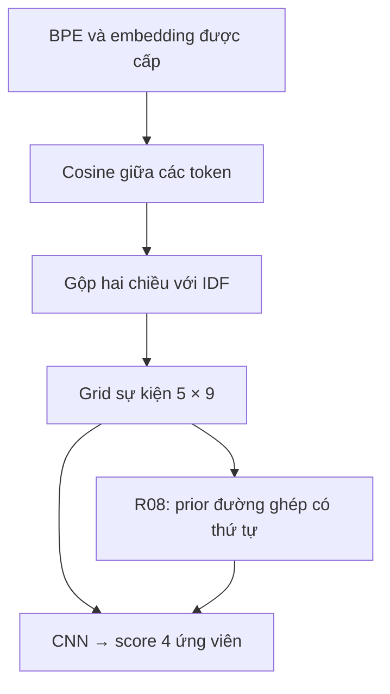
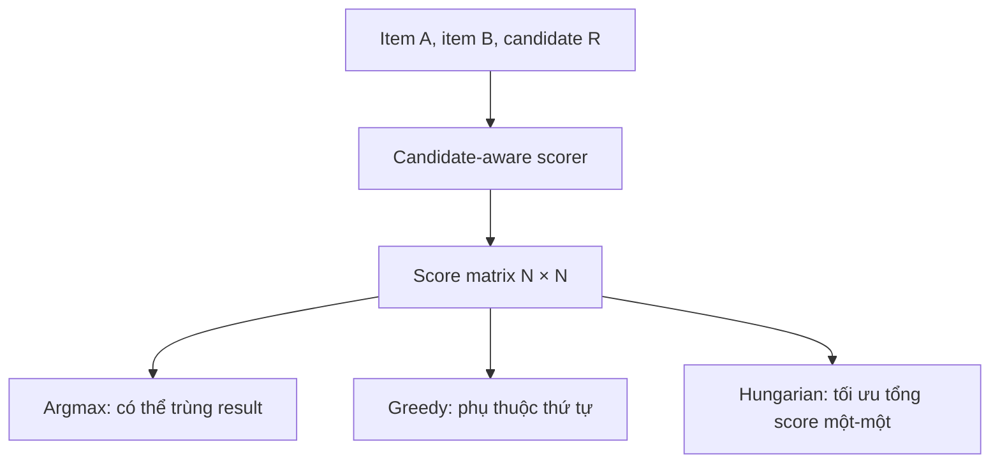

# Năm idea NLP cần mang vào phòng thi

Đọc từng bài theo input → điều model còn thiếu → thay đổi có căn cứ → phép đo quyết định. Số của nguồn, validation tự chạy và leaderboard là ba loại bằng chứng riêng.

## 1. Moment Match: giữ bằng chứng khớp, rồi thêm cấu trúc

Input là một cửa sổ 5 sự kiện và bốn ứng viên, mỗi ứng viên 9 sự kiện. Output chọn một trong bốn. Average embedding cả cửa sổ làm các hành động quan trọng bị pha loãng. Reference giữ ma trận tương tác token-token, gộp thành grid event-event rồi CNN chấm bốn lựa chọn.

Bảy lượt đã đo: soft alignment 65.44%; token attention 66.38%; event context 60.43%; IDF 69.12%; temperature nhỏ 66.10%; chỉ target center 49.10%; token attention+IDF 66.48%. IDF tốt hơn thêm layer trong loạt này. Center-only giảm mạnh cho thấy context có ích; event Transformer giảm điểm chỉ nói cách ghép đó chưa tốt. Đã thử thêm R08 monotonic DP68.93%, R09 hard max67.71%, R10 BPE+word-feature64.87%; chưa vượt IDF69.12%. Đây là kết quả bác bỏ các ứng viên trong ngân sách hiện tại, không phải bằng chứng các cơ chế đó luôn kém.

**Khi áp dụng:** matching, retrieval, VQA có candidate. Hỏi “feature đang được gộp quá sớm không?” trước khi tăng backbone. Với VQA, giữ token ảnh/text để tương tác có thể cần thiết hơn concatenate hai vector đã pooling, nhưng vẫn phải ablate trên validation.

## 2. Lost Interpreter: biểu diễn chương trình khác với thực thi chương trình

Một chuỗi opcode/giá trị vào, một scalar ra. Transformer + regression head có thể học tương quan mà không tạo trạng thái thực thi. Special tokens đánh dấu vai trò, không tự cung cấp logic số học.

BPE → embedding/position → encoder → mean/max hoặc query pooling → scalar head. R01 MAE36.26; markers37.94; numeric summaries37.67; query37.77; count auxiliary37.61. Những số này trên cùng 3,000 holdout, chưa vượt ứng viên đầu. Không lấy MAE22.65 của reference chia fold khác làm một phép so sánh cặp.

**Câu hỏi nâng cấp:** một con số có giữ giá trị thật và đúng vị trí lệnh không? Mô hình có thể cập nhật trạng thái theo thứ tự không? Global sum/min/max làm mất opcode và thứ tự. R08 BiGRU với packing/mask và SmoothL1 đạt **MAE15.31**, giảm57.8% so36.26 trên cùng holdout; đây là ứng viên kết hợp backbone+loss, không phải ablation chỉ đổi một yếu tố. Kiến trúc mới hơn không bảo đảm hợp hơn.

## 3. Word Lookups: học không nhãn và chọn đúng đại lượng để đo

Không có nhãn tách từ để train. Reference tận dụng khó/dễ dự đoán ký tự làm tín hiệu ranh giới. Lượt mới dùng BPE từ train, causal Transformer, surprisal và offset để quay về ranh giới ký tự, rồi decode thành BMES.

Surprisal lớn có thể báo chuyển từ nhưng cũng có thể do ký tự hiếm. Một BPE piece có thể chứa nhiều từ hoặc chỉ là phần của từ. Vì vậy thử PMI cohesion, hai chiều, punctuation và prior độ dài từ. DP quyết định cả segmentation thay vì từng boundary độc lập.

**Ba phép đo khác nhau:** NLL đo dự đoán token; Boundary F1 đo ranh giới; kiểm tra BMES đo định dạng. Chuỗi đúng chiều dài chưa có nghĩa tách từ tốt. NLL mỗi token cũng không so ngang khi tokenizer/corpus đổi. Giữ các submission cố định trước khi xem điểm; không đọc gold test để chọn threshold rồi gọi là validation.

Kết quả đã chấm public/private: R01 0.7559/0.7560; R02 hai chiều 0.8179/0.8214; R03 chuẩn hóa 0.7604/0.7594; R04 PMI 0.8766/0.8775; R05 DP 0.7578/0.7583; R06 dấu câu 0.8196/0.8215; R07 kết hợp 0.9097/0.9113. PMI và punctuation đem lại cải thiện lớn dù NLL giữ nguyên; R07 cùng NLL với R02 nhưng F1 hơn0.09. Tách từ ở đây cải thiện nhờ tín hiệu/decoder cấu trúc.

## 4. Inverse Translation: làm mục tiêu dễ tối ưu hơn

Đây là tìm input token sao cho model dịch cho ra một target đã được đề cung cấp. Không train model mới; trọng số và token ID của FSMT phải giữ nguyên. Tự BPE lại sẽ làm sai mapping.

Reference thay edit distance của output rời rạc bằng margin ở logits có teacher forcing. Khi target logit đứng cao nhất ở mọi vị trí, margin về 0. Probe từng Alien token để giữ top-k proposal theo English token, rồi thử đổi từng vị trí input. Dùng GPU chấm cả lô thay từng ứng viên. Canary bốn ví dụ phải khớp và evaluator gốc phải xác nhận; chỉ margin thấp chưa đủ.

Bản sạch đã chạy đủ bảy cấu hình: top8 đạt94.61 (22/24 exact), top16 đạt96.86 (23/24), còn top32/margin, CE, coarse, coordinate và restart đạt100. Coordinate giảm candidate evaluations9624→7832 và runtime16.29→11.97s trong batch; timing một lượt có warm-up nên chưa là benchmark thống kê. Học tối ưu chi phí tại cùng score100, không hứa tăng điểm vượt100.

## 5. Alchemy: model chấm score và decoder giải bài toán toàn cục

Mỗi cặp item được ghép đúng một result, mỗi result dùng đúng một lần. Encode riêng rồi cosine hạn chế tương tác; cross-encoder cho candidate tham gia tạo feature. Sau đó Hungarian tận dụng ràng buộc một-một, khác chọn argmax độc lập hoặc greedy theo thứ tự dòng.

Theo yêu cầu người học, các lượt đều scratch BPE. 120 rule train/30 result-disjoint holdout: R01 3/30; hard negatives4/30; full CE3/30; bốn layer2/30; probability average2/30; Sinkhorn3/30; kết hợp2/30. BERT pretrained được đề cho phép nhưng không bắt buộc; điểm reference pretrained không phải đối chứng cùng điều kiện.

**Điều cần học:** thay decoder có thể tăng độ đúng mà không đổi scorer; tăng complexity không tạo ra world knowledge thiếu trong 120 mẫu. R08 composer giao hoán `[a+b, |a-b|, a*b]` bảo đảm swap gap0 nhưng vẫn3/30. R09 chia sẻ input/result role space và query additive+residual đạt5/30; đây là ứng viên tốt nhất hiện tại nhưng mẫu30 quá nhỏ để khẳng định tăng ổn định.

## Cách đọc một lượt experiment

- Giả thuyết phải có cơ chế và phép đo có thể bác bỏ.
- Giữ split, seed và ngân sách; ghi rõ nếu một ứng viên đổi nhiều yếu tố.
- Chọn từ validation phù hợp; không lấy proxy của một task làm metric task khác.
- Nhìn lỗi theo nhóm và chi phí trước khi thêm model lớn.
- Một seed và 30 holdout không đủ khẳng định tăng một câu là ổn định.

Nguồn gốc reference và SHA nằm ở SOURCES.json; hướng nghiên cứu và link paper ở RESEARCH_NEXT.md. Kết quả mới nhất ở STATUS.md và từng runs/Rxx/LEARNED.md. Toàn bộ41 thí nghiệm đã hoàn tất và được audit; điểm vẫn có giới hạn của split, seed, metric và điều kiện pretrained như ghi trong từng báo cáo.
