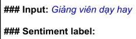
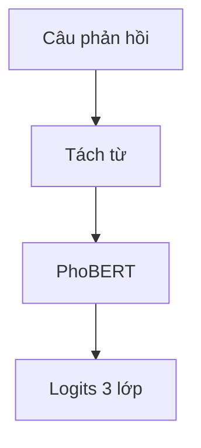

# UIT-VSFC · Cảm xúc phản hồi sinh viên

Một câu tiếng Việt → tiêu cực, trung tính hoặc tích cực.

**Metric** · Macro-F1 ↑

**Đề luyện 5 tiếng** · Giữ tỉ lệ lớp, nhóm các câu trùng sau chuẩn hóa. Lấy tối đa 6.000 câu train. [Dữ liệu và điều kiện truy cập](https://huggingface.co/datasets/uitnlp/vietnamese_students_feedback).

Cùng một câu phản hồi có thể đưa vào classifier hoặc làm input của prompt. *Trích Hình 1, input minh họa trong paper đánh giá sentiment, Dang Van Thin, Duong Ngoc Hao & Ngan Luu-Thuy Nguyen.* [PDF gốc, trang 4](https://aclanthology.org/2024.paclic-1.17.pdf#page=4).

## Từ baseline đến mô hình mạnh

1. **Baseline.** TF-IDF ký tự 3–5 + logistic regression.
2. **Thử nghiệm tiếp theo.** Lọc riêng câu có “không”, “chưa” và lớp trung tính. Nếu sai phủ định, thêm word bigram và so với char-only.
3. **Kiến trúc nghiên cứu.** PhoBERT + đầu phân lớp. Tách từ bằng cùng quy ước với checkpoint, rồi fine-tune các tầng trên.

## Kiến trúc để thử

Khối code có thể tái sử dụng · [FeatureUnion cho word/char n-grams và linear classifier](../linear.py).

## Mốc công bố và hướng SOTA

PhoBERT gốc báo NER và NLI, đo macro-F1 sentiment trên UIT-VSFC bằng split ghi trên trang này. [Thí nghiệm hoặc kiến trúc gốc, tr. 4](https://aclanthology.org/2020.findings-emnlp.92.pdf#page=4).

Xem bảng UIT-VSFC của bài so sánh sentiment tiếng Việt, chọn cùng kiểu average trước khi so classifier đã fine-tune với prompting. [Paper hoặc bảng đối chiếu](https://aclanthology.org/2024.paclic-1.17.pdf).

**Run CPU.** 6.000 mẫu train stratified, 1.583 mẫu validation chính thức. Word + char TF-IDF đạt macro-F1 **0,7448**. Lớp trung tính đạt F1 **0,4082**. [Tái lập](../README.md#tái-lập-bài-tiếng-việt).

[← Trở về danh sách 30 challenge](../README.md)
