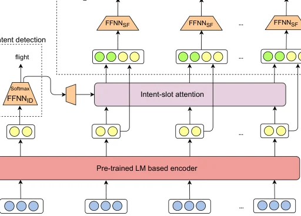
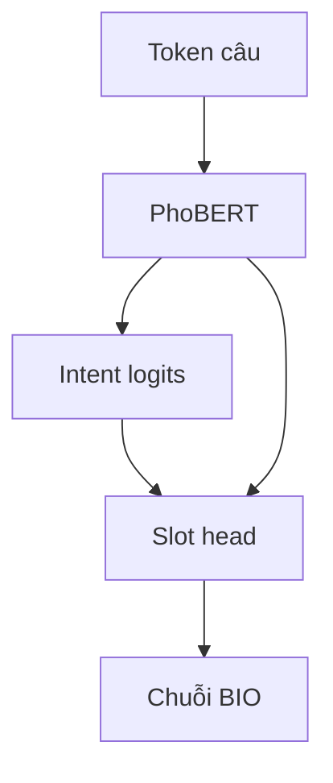

# PhoATIS · Intent và slot trong cùng câu

Câu hỏi chuyến bay → intent của câu và nhãn BIO từng từ.

**Metric** · Intent accuracy, span F1 và exact match cả khung ↑

**Đề luyện 5 tiếng** · Chọn 4.000 câu, chia theo utterance gốc. Giữ vị trí token trước khi tokenize. [Dữ liệu và điều kiện truy cập](https://github.com/VinAIResearch/JointIDSF).

Nhánh intent gửi đặc trưng sang phần gán slot cho từng vị trí. *Trích Hình 1, Dao và cộng sự.* [PDF gốc, trang 2](https://arxiv.org/pdf/2104.02021#page=2).

## Từ baseline đến mô hình mạnh

1. **Baseline.** TF-IDF cho intent, từ điển thành phố cho slot.
2. **Thử nghiệm tiếp theo.** Intent đúng nhưng mất điểm khung khi gán nhầm nơi đi và nơi đến. Thêm hai đầu dự đoán dùng chung encoder, chỉ tính slot loss trên subword đầu của mỗi từ.
3. **Kiến trúc nghiên cứu.** JointIDSF dùng tín hiệu intent cho slot, so joint với hai head độc lập trên cùng PhoBERT.

## Kiến trúc để thử

Khối code có thể tái sử dụng · [Đọc chuỗi có nhãn và giữ ranh giới câu](../blocks/sequence.py).

## Mốc công bố và hướng SOTA

Bảng 2, JointIDSF + PhoBERT đạt 97,62% intent accuracy, 94,98 slot F1 và 86,25% sentence accuracy trên test PhoATIS. [Thí nghiệm hoặc kiến trúc gốc, tr. 4](https://arxiv.org/pdf/2104.02021#page=4).

So joint intent/slot với mô hình multi-intent VSLIM, đối chiếu bảng PhoATIS single-intent và giữ metric sentence accuracy. [Paper hoặc bảng đối chiếu](https://lexuanbach.github.io/publication/ACIIDS2026b.pdf).

[← Trở về danh sách 30 challenge](../README.md)
