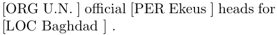
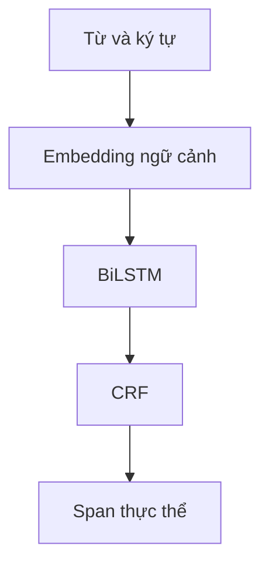

# CoNLL-2003 · Nhận diện thực thể

Chuỗi từ → span PER, ORG, LOC, MISC.

**Metric** · Micro-F1 trên span khớp cả biên và loại ↑

**Đề luyện 5 tiếng** · Dùng phần tiếng Anh, chia theo tài liệu, giữ nguyên câu và dòng trống. [Dữ liệu và điều kiện truy cập](https://www.cnts.ua.ac.be/conll2003/ner/).

Một câu có nhiều loại thực thể; metric cần đúng cả hai biên. *Trích Ví dụ gán nhãn trong mục 1, Tjong Kim Sang & De Meulder.* [PDF gốc, trang 1](https://aclanthology.org/W03-0419.pdf#page=1).

## Từ baseline đến mô hình mạnh

1. **Baseline.** Tra gazetteer từ train, chọn cụm dài nhất khớp.
2. **Thử nghiệm tiếp theo.** Đếm lỗi đúng loại nhưng lệch một từ. Thêm embedding → BiLSTM → CRF và đối chiếu với softmax từng token.
3. **Kiến trúc nghiên cứu.** Flair dùng representation ngữ cảnh theo ký tự, hữu ích với từ hiếm, so bằng conlleval.

## Kiến trúc để thử

Khối code có thể tái sử dụng · [Đọc chuỗi có nhãn và giữ ranh giới câu](../blocks/sequence.py).

## Mốc công bố và hướng SOTA

Bảng 2, biến thể contextual string + word + character đạt 93,09 ± 0,12 F1 trên tiếng Anh. Giữ script chấm entity-level khi so. [Thí nghiệm hoặc kiến trúc gốc, tr. 7](https://aclanthology.org/C18-1139.pdf#page=7).

ACE chọn tổ hợp contextual embeddings cho structured prediction. Với ngân sách ngắn, kiểm tra một embedding mạnh trước khi ghép nhiều encoder. [Paper hoặc bảng đối chiếu](https://aclanthology.org/2021.acl-long.206/).

[← Trở về danh sách 30 challenge](../README.md)
