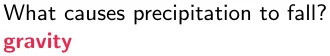
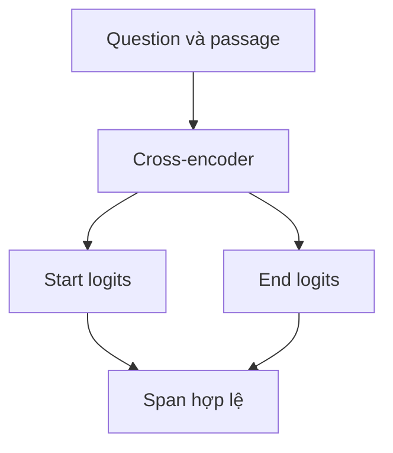

# SQuAD 1.1 · Trích đoạn trả lời

Câu hỏi và đoạn Wikipedia → vị trí đầu/cuối trong văn bản gốc.

**Metric** · EM và token F1 ↑

**Đề luyện 5 tiếng** · Lấy 5.000 cặp train, giữ nguyên article trong một split. Không đổi hoa thường trước khi tính offset. [Dữ liệu và điều kiện truy cập](https://rajpurkar.github.io/SQuAD-explorer/).

Khi câu trả lời ngắn, lệch một từ đủ làm mất exact match. *Trích Hình 1, một cặp hỏi–đáp, Rajpurkar và cộng sự.* [PDF gốc, trang 1](https://aclanthology.org/D16-1264.pdf#page=1).

## Từ baseline đến mô hình mạnh

1. **Baseline.** Xếp câu bằng TF-IDF, chọn cụm danh từ hoặc số gần từ khóa nhất.
2. **Thử nghiệm tiếp theo.** Đo recall của câu chứa đáp án trước. Khi câu đúng nhưng span sai, train hai head start/end và ép end ≥ start.
3. **Kiến trúc nghiên cứu.** BERT reader học phân bố biên trên token ngữ cảnh, nối offset về văn bản để chấm.

## Kiến trúc để thử

Khối code có thể tái sử dụng · [Encoder và mask cho batch có padding](../blocks/transformers.py).

## Mốc công bố và hướng SOTA

Bảng 2, BERT-Large single trên SQuAD 1.1 dev đạt 84,1 EM và 90,9 F1. Hàng dùng thêm TriviaQA là điều kiện khác. [Thí nghiệm hoặc kiến trúc gốc, tr. 7](https://aclanthology.org/N19-1423.pdf#page=7).

SpanBERT pretrain bằng span masking và học biểu diễn biên. So single-model F1 với reader BERT trong điều kiện cùng dữ liệu. [Paper hoặc bảng đối chiếu](https://aclanthology.org/2020.tacl-1.5/).

[← Trở về danh sách 30 challenge](../README.md)
