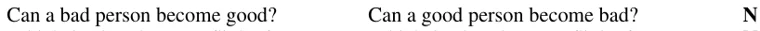
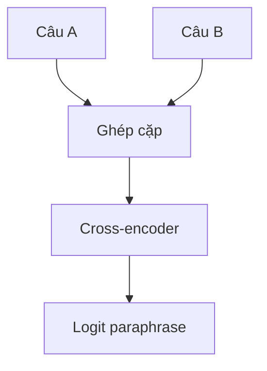

# PAWS · Phân biệt đảo vai nghĩa

Hai câu có vốn từ gần giống → có diễn đạt cùng nghĩa?

**Metric** · Accuracy ↑

**Đề luyện 5 tiếng** · Chọn PAWS-Wiki, giữ toàn bộ biến thể của cùng câu nguồn ở một split. [Dữ liệu và điều kiện truy cập](https://github.com/google-research-datasets/paws).

Thử đảo hai vai trong câu rồi kiểm tra lại nhãn của cặp. *Trích Bảng 1, một phương án, Zhang và cộng sự.* [PDF gốc, trang 2](https://aclanthology.org/N19-1131.pdf#page=2).

## Từ baseline đến mô hình mạnh

1. **Baseline.** Cosine TF-IDF với ngưỡng trên dev.
2. **Thử nghiệm tiếp theo.** Xem các cặp đảo chủ thể–đối tượng. So bigram có thứ tự, sau đó nối hai câu qua cross-encoder.
3. **Kiến trúc nghiên cứu.** PAWS fine-tuning BERT dùng hard negatives có lexical overlap cao, đối chiếu PAWS-Wiki test.

## Kiến trúc để thử

Khối code có thể tái sử dụng · [FeatureUnion cho word/char n-grams và linear classifier](../linear.py).

## Mốc công bố và hướng SOTA

Bảng 7–8 đối chiếu train thông thường và train có cặp PAWS. Đọc riêng cột Wikipedia trước khi so dữ liệu QQP. [Thí nghiệm hoặc kiến trúc gốc, tr. 8](https://aclanthology.org/N19-1131.pdf#page=8).

PAWS-X mở rộng phép thử sang nhiều ngôn ngữ. Tách đánh giá robustness cross-lingual khỏi PAWS-Wiki English. [Paper hoặc bảng đối chiếu](https://aclanthology.org/D19-1382/).

[← Trở về danh sách 30 challenge](../README.md)
