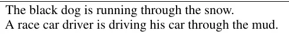
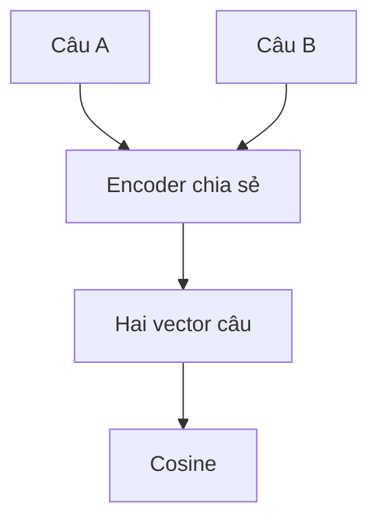

# STS-B · Đo tương đồng theo thang liên tục

Hai câu → điểm tương đồng 0–5.

**Metric** · Pearson r và Spearman ρ ↑

**Đề luyện 5 tiếng** · Dùng STS Benchmark tiếng Anh, giữ split gốc và báo thêm theo thể loại. [Dữ liệu và điều kiện truy cập](https://huggingface.co/datasets/nyu-mll/glue/viewer/stsb).

Thang điểm có thứ tự; dự đoán cần giữ đúng thứ hạng của cặp. *Trích Bảng 1, cặp câu có mức tương đồng thấp, Cer và cộng sự.* [PDF gốc, trang 2](https://aclanthology.org/S17-2001.pdf#page=2).

## Từ baseline đến mô hình mạnh

1. **Baseline.** Cosine TF-IDF → hồi quy tuyến tính lên thang 0–5.
2. **Thử nghiệm tiếp theo.** Hai câu tương đương nhưng ít từ chung cho cosine thấp. Dùng mean pooling có padding mask rồi học cosine bằng MSE.
3. **Kiến trúc nghiên cứu.** Sentence-BERT dùng hai encoder chia sẻ trọng số, cho phép cache từng câu khi truy vấn lặp.

## Kiến trúc để thử

Khối code có thể tái sử dụng · [Encoder và mask cho batch có padding](../blocks/transformers.py).

## Mốc công bố và hướng SOTA

Bảng 2, SBERT-STSb-base đạt 84,67 ± 0,19 Spearman ×100 trên test khi đã fine-tune theo STS-B. [Thí nghiệm hoặc kiến trúc gốc, tr. 5](https://aclanthology.org/D19-1410.pdf#page=5).

SimCSE học sentence embeddings bằng contrastive learning, so Pearson/Spearman trên cùng bản STS-B và loại supervision. [Paper hoặc bảng đối chiếu](https://aclanthology.org/2021.emnlp-main.552.pdf).

[← Trở về danh sách 30 challenge](../README.md)
