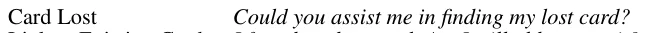
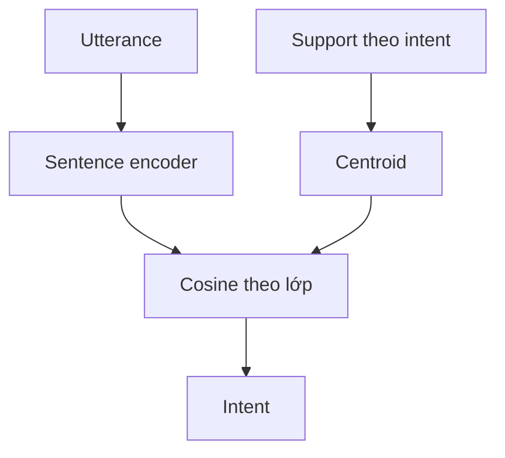

# BANKING77 · Phân biệt intent gần nhau

Yêu cầu dịch vụ → một trong 77 intent.

**Metric** · Accuracy ↑

**Đề luyện 5 tiếng** · Chọn 10 câu mỗi lớp ở train để luyện few-shot, test trên split tác giả. [Dữ liệu và điều kiện truy cập](https://github.com/PolyAI-LDN/task-specific-datasets).

Tên intent nằm ở cột trái và cách diễn đạt yêu cầu nằm ở cột phải. *Trích Bảng 2, ví dụ intent, Casanueva và cộng sự.* [PDF gốc, trang 4](https://aclanthology.org/2020.nlp4convai-1.5.pdf#page=4).

## Từ baseline đến mô hình mạnh

1. **Baseline.** TF-IDF + linear SVM.
2. **Thử nghiệm tiếp theo.** Lập ma trận nhầm giữa các intent gần nhau. Ghép support theo lớp thành centroid và so word/char với embedding câu.
3. **Kiến trúc nghiên cứu.** Dual sentence encoders tối ưu embedding truy vấn–intent, đối chiếu các chế độ 10/30/full theo bài gốc.

## Kiến trúc để thử

Khối code có thể tái sử dụng · [FeatureUnion cho word/char n-grams và linear classifier](../linear.py).

## Mốc công bố và hướng SOTA

Bảng 3, USE đạt 84,23% với 10 ví dụ mỗi intent và 92,81% với toàn bộ train BANKING77. [Thí nghiệm hoặc kiến trúc gốc, tr. 4](https://aclanthology.org/2020.nlp4convai-1.5.pdf#page=4).

SetFit học embedding câu bằng các cặp contrastive rồi fit classifier. Với intent mới, chốt trước số mẫu mỗi lớp, với OOS, chọn ngưỡng bằng dev ngoài miền. [Paper hoặc bảng đối chiếu](https://arxiv.org/abs/2209.11055).

[← Trở về danh sách 30 challenge](../README.md)
