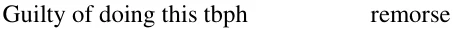
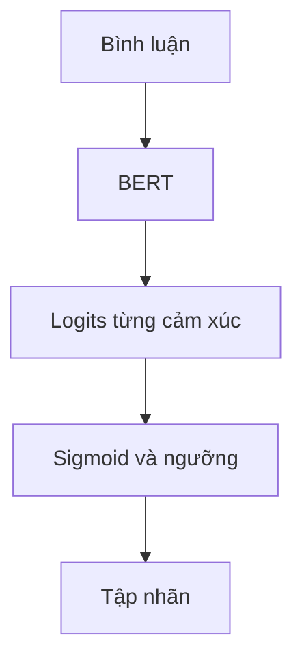

# GoEmotions · Phân loại đa nhãn

Bình luận → tập cảm xúc, có thể có nhiều nhãn.

**Metric** · Macro-F1 ↑

**Đề luyện 5 tiếng** · Dùng bản simplified, lấy 8.000 bình luận, giữ tất cả nhãn mỗi dòng. [Dữ liệu và điều kiện truy cập](https://github.com/google-research/google-research/tree/master/goemotions).

Một dòng văn bản đi kèm tập nhãn cảm xúc. *Trích Bảng 1, một dòng nhãn, Demszky và cộng sự.* [PDF gốc, trang 1](https://aclanthology.org/2020.acl-main.372.pdf#page=1).

## Từ baseline đến mô hình mạnh

1. **Baseline.** TF-IDF với one-vs-rest logistic, ngưỡng 0,5.
2. **Thử nghiệm tiếp theo.** Kiểm tra precision/recall từng nhãn hiếm. Chọn một ngưỡng chung trên dev trước khi thử ngưỡng mỗi lớp.
3. **Kiến trúc nghiên cứu.** BERT với sigmoid độc lập + BCE, phân tích tương quan các nhãn hay đi cùng nhau.

## Kiến trúc để thử

Khối code có thể tái sử dụng · [FeatureUnion cho word/char n-grams và linear classifier](../linear.py).

## Mốc công bố và hướng SOTA

BERT baseline trong bài GoEmotions đạt F1 trung bình 0,46 cho hệ nhãn chi tiết. Bài rút gọn phải báo class support. [Thí nghiệm hoặc kiến trúc gốc, tr. 7](https://aclanthology.org/2020.acl-main.372.pdf#page=7).

Xem cơ chế học quan hệ giữa nhãn của các mô hình emotion classification, đánh giá trên đúng hệ nhãn GoEmotions và macro-F1. [Paper hoặc bảng đối chiếu](https://arxiv.org/abs/2005.00547).

[← Trở về danh sách 30 challenge](../README.md)
