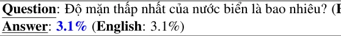
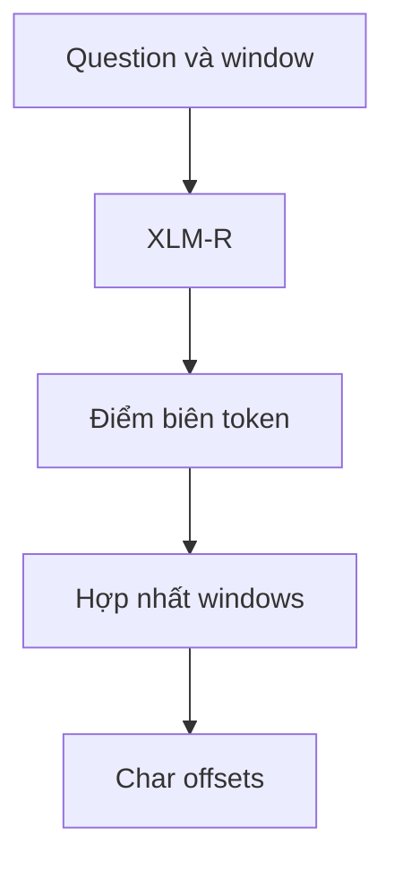

# UIT-ViQuAD · Đọc hiểu tiếng Việt

Câu hỏi và đoạn tiếng Việt → chuỗi con nguyên văn.

**Metric** · EM và F1 theo evaluator của bộ dữ liệu ↑

**Đề luyện 5 tiếng** · Chọn 3.000 cặp theo article. Giữ văn bản Unicode gốc để phục hồi đáp án. [Dữ liệu và điều kiện truy cập](https://nlp.uit.edu.vn/datasets/).

Đối chiếu ký tự đáp án trong passage trước khi ánh xạ subword. *Trích Hình 1, một phần câu hỏi và span, Nguyen và cộng sự.* [PDF gốc, trang 2](https://aclanthology.org/2020.coling-main.233.pdf#page=2).

## Từ baseline đến mô hình mạnh

1. **Baseline.** BM25 theo câu + chọn span quanh từ trùng.
2. **Thử nghiệm tiếp theo.** Một từ sau word segmentation có thể gồm nhiều âm tiết. Kiểm tra round-trip char offset trước khi thêm sliding windows.
3. **Kiến trúc nghiên cứu.** XLM-R QA reader học start/end và chọn span tốt nhất giữa các cửa sổ, chạy riêng câu hỏi dài.

## Kiến trúc để thử

Khối code có thể tái sử dụng · [Encoder và mask cho batch có padding](../blocks/transformers.py).

## Mốc công bố và hướng SOTA

Bảng 5, XLM-R-Large đạt 68,98 EM và 87,02 F1 trên test UIT-ViQuAD. Dev tương ứng 69,18 và 87,14. [Thí nghiệm hoặc kiến trúc gốc, tr. 7](https://aclanthology.org/2020.coling-main.233.pdf#page=7).

So XLM-R với reference cùng phiên bản UIT-ViQuAD. ViQuAD có unanswerable questions cần thêm bước reject ở bản hỗ trợ. [Paper hoặc bảng đối chiếu](https://vlsp.org.vn/vlsp2021/eval/mrc).

[← Trở về danh sách 30 challenge](../README.md)
