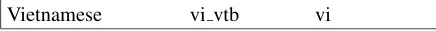
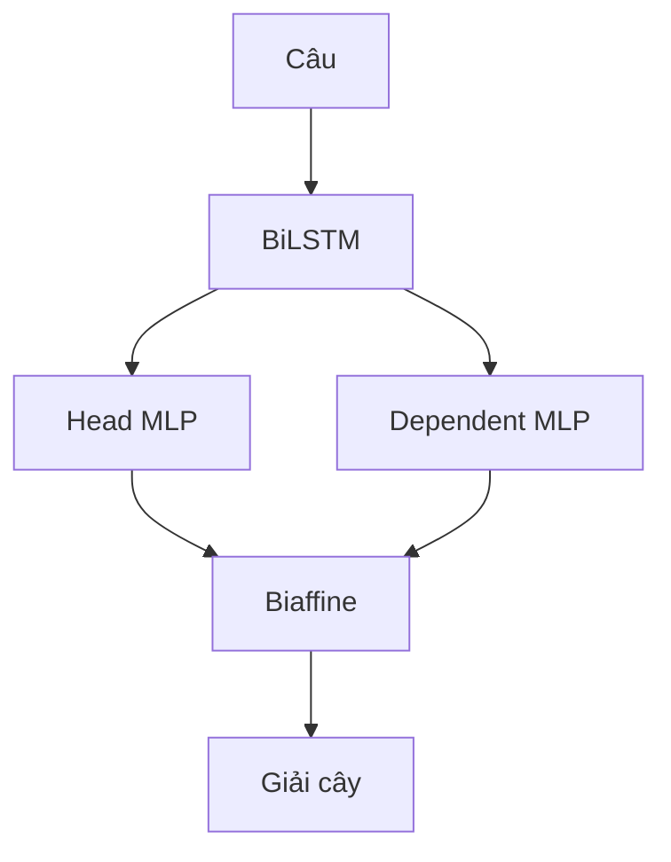

# Universal Dependencies · Phân tích phụ thuộc

Câu đã tách từ → head và quan hệ cho từng từ.

**Metric** · LAS và UAS ↑ trên tokenization vàng của bài luyện

**Đề luyện 5 tiếng** · Một treebank UD Vietnamese VTB, giữ file train/dev/test và bỏ dòng multiword/empty nodes khi đọc. [Dữ liệu và điều kiện truy cập](https://universaldependencies.org/treebanks/vi_vtb/).

Treebank ID xác định bộ file, ngôn ngữ và split để so LAS. *Trích Bảng 1, hàng tiếng Việt, Zeman và cộng sự.* [PDF gốc, trang 3](https://aclanthology.org/K18-2001.pdf#page=3).

## Từ baseline đến mô hình mạnh

1. **Baseline.** Mỗi từ nối về từ bên trái, gán quan hệ thường gặp nhất theo POS.
2. **Thử nghiệm tiếp theo.** Chấm theo độ dài cạnh. Học score cho từng cặp head–dependent và giải cây có một gốc.
3. **Kiến trúc nghiên cứu.** Deep biaffine parser có hai phép chiếu riêng cho head và dependent, chấm arc và relation riêng.

## Kiến trúc để thử

Khối code có thể tái sử dụng · [Đọc chuỗi có nhãn và giữ ranh giới câu](../blocks/sequence.py).

## Mốc công bố và hướng SOTA

Bảng 4–5 của biaffine parser dùng các treebank trong paper. Đánh giá lại LAS trên Vietnamese VTB và ghi điều kiện token vàng. [Thí nghiệm hoặc kiến trúc gốc, tr. 6](https://arxiv.org/pdf/1611.01734#page=6).

UDPipe Future học tag và parse trong pipeline. Đối chiếu LAS với đầu vào token vàng và LAS từ raw text để đo ảnh hưởng tách từ. [Paper hoặc bảng đối chiếu](https://universaldependencies.org/conll18/results-las.html).

[← Trở về danh sách 30 challenge](../README.md)
