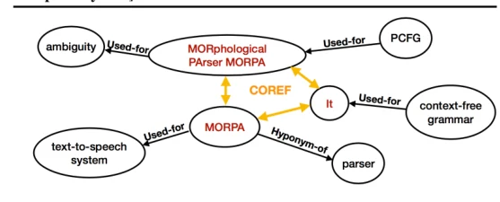
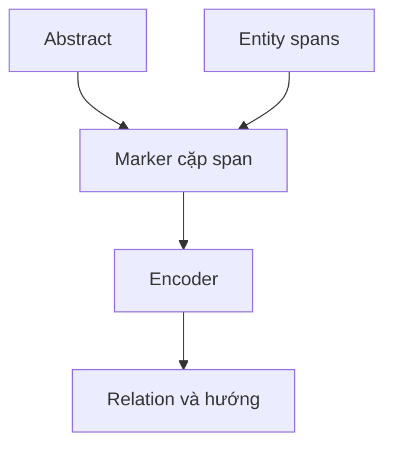

# SciERC · Quan hệ giữa thực thể khoa học

Abstract có entity spans → loại quan hệ cho từng cặp span.

**Metric** · Micro-F1 quan hệ dương ↑, dùng entity vàng trong bài rút gọn

**Đề luyện 5 tiếng** · Chọn toàn bộ abstract ngắn, tách theo tài liệu. Báo rõ điều kiện gold spans. [Dữ liệu và điều kiện truy cập](https://nlp.cs.washington.edu/sciIE/).

Cạnh có hướng nối hai span; đổi thứ tự có thể đổi nhãn quan hệ. *Trích Hình 1, graph, Luan và cộng sự.* [PDF gốc, trang 1](https://aclanthology.org/D18-1360.pdf#page=1).

## Từ baseline đến mô hình mạnh

1. **Baseline.** Tra cặp loại thực thể và cụm từ nằm giữa hai span.
2. **Thử nghiệm tiếp theo.** Đếm nhầm hướng USED-FOR. Thêm marker đầu/cuối hai span và negative pairs cùng câu.
3. **Kiến trúc nghiên cứu.** PURE tách mô hình entity và relation, đưa thông tin biên thực thể vào relation encoder.

## Kiến trúc để thử

Khối code có thể tái sử dụng · [Đọc chuỗi có nhãn và giữ ranh giới câu](../blocks/sequence.py).

## Mốc công bố và hướng SOTA

Bảng 1 của PURE báo end-to-end entity/relation F1. Bài dùng gold spans cần báo riêng số đó với pipeline predicted spans. [Thí nghiệm hoặc kiến trúc gốc, tr. 6](https://aclanthology.org/2021.naacl-main.5.pdf#page=6).

PL-Marker đóng gói nhiều marker vào một lần encode. Giữ cùng danh sách entity để tách gain của relation head khỏi gain của NER. [Paper hoặc bảng đối chiếu](https://aclanthology.org/2022.acl-long.337/).

[← Trở về danh sách 30 challenge](../README.md)
