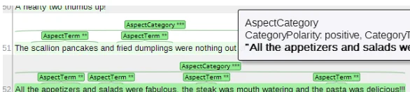
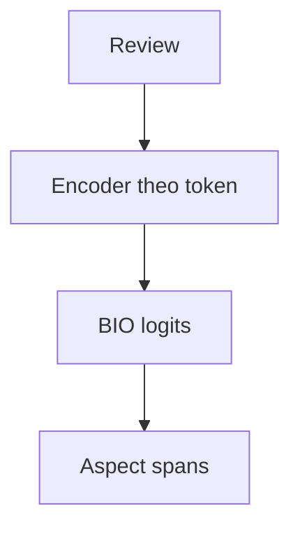

# SemEval 2014 · Tìm khía cạnh nhà hàng

Đánh giá nhà hàng → cụm từ chỉ khía cạnh, như “thời gian chờ”.

**Metric** · Exact aspect-term span F1 ↑

**Đề luyện 5 tiếng** · Dùng Restaurants subtask 1, giữ nguyên ký tự theo offsets XML. [Dữ liệu và điều kiện truy cập](https://alt.qcri.org/semeval2014/task4/).

Các đầu mút annotation chỉ vào cụm danh từ cần trích. *Trích Hình 2, một phần nhãn BRAT, Pontiki và cộng sự.* [PDF gốc, trang 4](https://aclanthology.org/S14-2004.pdf#page=4).

## Từ baseline đến mô hình mạnh

1. **Baseline.** Longest-match từ điển aspect của train.
2. **Thử nghiệm tiếp theo.** Lọc aspect nhiều từ và aspect chưa gặp, so BiLSTM BIO với CRF theo span F1.
3. **Kiến trúc nghiên cứu.** BERT-PT tiếp tục pretrain trên review rồi fine-tune extraction, bài thi chỉ dùng weights nếu đã có.

## Kiến trúc để thử

Khối code có thể tái sử dụng · [Đọc chuỗi có nhãn và giữ ranh giới câu](../blocks/sequence.py).

## Mốc công bố và hướng SOTA

Paper BERT-PT có thí nghiệm aspect extraction và aspect sentiment khác tập/năm, mốc cùng task 2014 Restaurants SB1 là DLIREC 84,01 F1, đứng đầu Bảng 4 của báo cáo shared task. [Thí nghiệm hoặc kiến trúc gốc, tr. 7](https://aclanthology.org/N19-1242.pdf#page=7). [Bảng 4, kết quả shared task](https://aclanthology.org/S14-2004.pdf#page=6).

Xem hệ DLIREC của shared task 2014 và đối chiếu đúng track restaurant aspect-term extraction. CRF + feature ngôn ngữ là phương án khi thi offline. [Paper hoặc bảng đối chiếu](https://alt.qcri.org/semeval2014/cdrom/pdf/SemEval038.pdf).

[← Trở về danh sách 30 challenge](../README.md)
