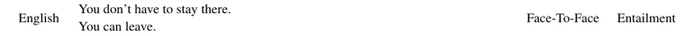
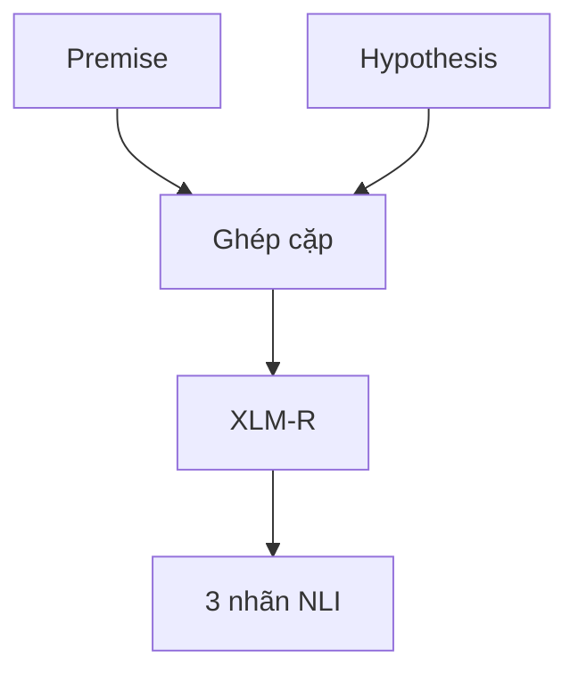

# XNLI · Suy diễn Anh–Việt

Premise và hypothesis → entailment, neutral hoặc contradiction.

**Metric** · Accuracy ↑

**Đề luyện 5 tiếng** · Train từ 6.000 cặp MNLI tiếng Anh, đánh giá riêng vi dev/test của XNLI, giữ dev để chọn model. [Dữ liệu và điều kiện truy cập](https://github.com/facebookresearch/XNLI).

Đối chiếu premise và hypothesis thuộc cùng một ngôn ngữ khi chấm zero-shot. *Trích Bảng 1, ví dụ theo ngôn ngữ, Conneau và cộng sự.* [PDF gốc, trang 2](https://aclanthology.org/D18-1269.pdf#page=2).

## Từ baseline đến mô hình mạnh

1. **Baseline.** TF-IDF Anh + linear classifier làm mốc chuyển ngữ.
2. **Thử nghiệm tiếp theo.** Tính độ rơi từ en sang vi trên cùng example ID. Thay phần mã hóa bằng multilingual encoder đã cache.
3. **Kiến trúc nghiên cứu.** XLM-R cross-encoder chia sẻ từ vựng đa ngữ, đối chiếu zero-shot với translate-train nếu có bản dịch.

## Kiến trúc để thử

Khối code có thể tái sử dụng · [Encoder và mask cho batch có padding](../blocks/transformers.py).

## Mốc công bố và hướng SOTA

Bảng 1 có kết quả theo từng ngôn ngữ và cách transfer. Dùng cột vi trong cùng chế độ cross-lingual. [Thí nghiệm hoặc kiến trúc gốc, tr. 7](https://aclanthology.org/2020.acl-main.747.pdf#page=7).

InfoXLM thêm mục tiêu alignment liên ngôn ngữ. Đọc riêng target vi và so cùng điều kiện English-only fine-tuning. [Paper hoặc bảng đối chiếu](https://aclanthology.org/2021.naacl-main.280/).

[← Trở về danh sách 30 challenge](../README.md)
