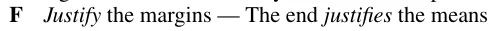
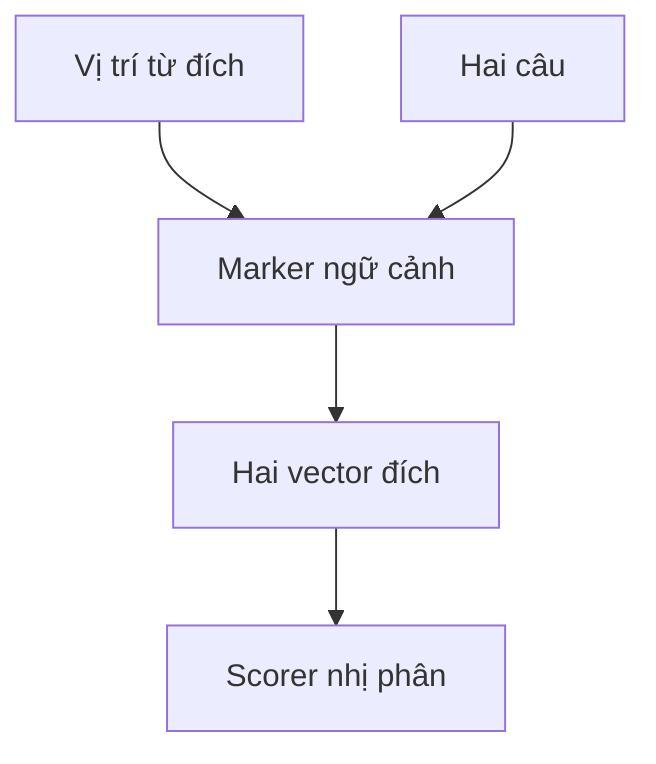

# WiC · Một từ có cùng nghĩa?

Hai ngữ cảnh và vị trí từ đích → cùng/khác nghĩa.

**Metric** · Accuracy ↑

**Đề luyện 5 tiếng** · Dùng split gốc, giữ chỉ số từ đích thay vì tìm theo lần xuất hiện đầu. [Dữ liệu và điều kiện truy cập](https://pilehvar.github.io/wic/).

Vị trí từ đích phân biệt bài này với đo độ giống cả câu. *Trích Bảng 1, ví dụ từ đa nghĩa, Pilehvar & Camacho-Collados.* [PDF gốc, trang 2](https://aclanthology.org/N19-1128.pdf#page=2).

## Từ baseline đến mô hình mạnh

1. **Baseline.** Cosine giữa túi từ xung quanh hai vị trí.
2. **Thử nghiệm tiếp theo.** Hai câu cùng chủ đề có thể dùng hai nghĩa khác nhau. Chèn marker quanh đúng từ đích, so với bỏ marker.
3. **Kiến trúc nghiên cứu.** WiC contextual embedding baseline lấy vector ngay tại từ đích trong từng câu rồi so theo ngưỡng.

## Kiến trúc để thử

Khối code có thể tái sử dụng · [FeatureUnion cho word/char n-grams và linear classifier](../linear.py).

## Mốc công bố và hướng SOTA

Bảng 3 so accuracy của biểu diễn ngữ cảnh và lexical baseline trên dev/test WiC. Kiểm tra có dùng embedding ngoài. [Thí nghiệm hoặc kiến trúc gốc, tr. 4](https://aclanthology.org/N19-1128.pdf#page=4).

T5 thống nhất các bài SuperGLUE dưới dạng text-to-text. Đọc điểm theo task và kích thước model, đưa ý tưởng transfer xuống checkpoint nhỏ nếu có. [Paper hoặc bảng đối chiếu](https://hmjianggatech.github.io/files/T5.pdf).

[← Trở về danh sách 30 challenge](../README.md)
