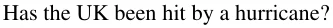
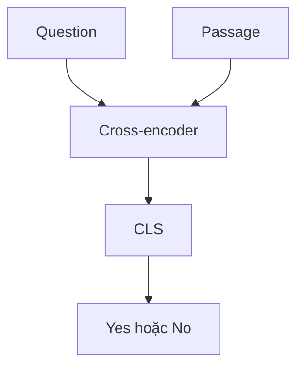

# BoolQ · Đọc hiểu có/không

Câu hỏi tự nhiên + đoạn dẫn → yes/no.

**Metric** · Accuracy ↑

**Đề luyện 5 tiếng** · Lấy 5.000 dòng train, giữ dev theo bài gốc, báo accuracy của majority. [Dữ liệu và điều kiện truy cập](https://github.com/google-research-datasets/boolean-questions).

Một câu hỏi yes/no vẫn đòi hỏi bằng chứng từ passage. *Trích Hình 1, câu hỏi, Clark và cộng sự.* [PDF gốc, trang 1](https://aclanthology.org/N19-1300.pdf#page=1).

## Từ baseline đến mô hình mạnh

1. **Baseline.** Chỉ dùng question TF-IDF để đo thiên lệch mẫu câu.
2. **Thử nghiệm tiếp theo.** Đảo passage giữa các ví dụ, đo độ giảm accuracy. Thêm cross-attention giữa question và passage.
3. **Kiến trúc nghiên cứu.** BoolQ nghiên cứu transfer từ NLI trước khi fine-tune reader yes/no, so với khởi tạo cùng backbone.

## Kiến trúc để thử

Khối code có thể tái sử dụng · [FeatureUnion cho word/char n-grams và linear classifier](../linear.py).

## Mốc công bố và hướng SOTA

Bảng 3–4 tách dev và test, có ablation thêm MultiNLI trước khi fine-tune BoolQ. [Thí nghiệm hoặc kiến trúc gốc, tr. 8](https://aclanthology.org/N19-1300.pdf#page=8).

T5 thống nhất các bài SuperGLUE dưới dạng text-to-text. Đọc điểm theo task và kích thước model, đưa ý tưởng transfer xuống checkpoint nhỏ nếu có. [Paper hoặc bảng đối chiếu](https://hmjianggatech.github.io/files/T5.pdf).

[← Trở về danh sách 30 challenge](../README.md)
