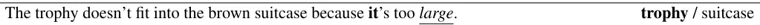
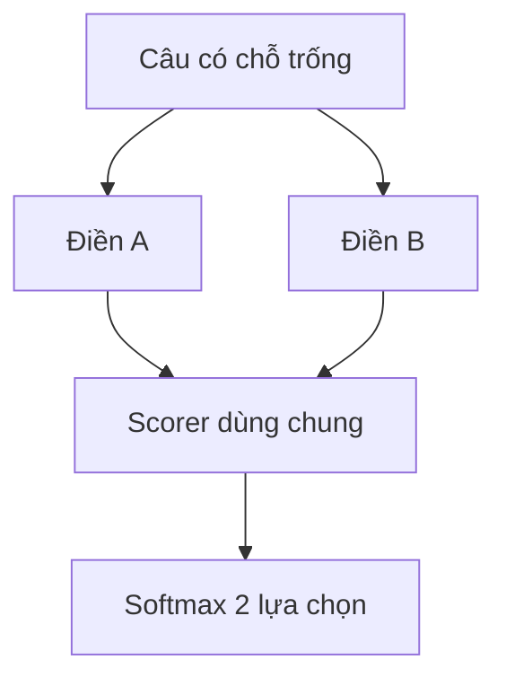

# WinoGrande · Chọn từ điền đại từ

Câu có ô trống, hai ứng viên → chỉ số ứng viên.

**Metric** · Accuracy ↑

**Đề luyện 5 tiếng** · Dùng train XS/S và dev gốc, nhóm các cặp gần trùng khi chia thêm validation. [Dữ liệu và điều kiện truy cập](https://github.com/allenai/winogrande).

Một thay đổi nhỏ trong câu có thể đổi tham chiếu của đại từ. *Trích Bảng 1, một vế ví dụ WSC, Sakaguchi và cộng sự.* [PDF gốc, trang 2](https://arxiv.org/pdf/1907.10641#page=2).

## Từ baseline đến mô hình mạnh

1. **Baseline.** Điền từng ứng viên, chấm log-prob của phần suffix bằng LM nếu có, hoặc LM n-gram train-only.
2. **Thử nghiệm tiếp theo.** Kiểm tra thiên lệch theo vị trí bằng hoán đổi đáp án. Học một scorer dùng chung cho hai câu đã điền.
3. **Kiến trúc nghiên cứu.** WinoGrande dùng RoBERTa multiple choice trên các biến thể đã lọc đối kháng.

## Kiến trúc để thử

Khối code có thể tái sử dụng · [Encoder và mask cho batch có padding](../blocks/transformers.py).

## Mốc công bố và hướng SOTA

Bảng 4 thay đổi số mẫu train. Chọn đúng XS/S khi đối chiếu với buổi luyện ít dữ liệu. [Thí nghiệm hoặc kiến trúc gốc, tr. 6](https://arxiv.org/pdf/1907.10641#page=6).

Đối chiếu learning curve XS→XL của WinoGrande với accuracy trên split gốc để tránh gán gain từ nhiều data cho kiến trúc. [Paper hoặc bảng đối chiếu](https://github.com/allenai/winogrande/blob/master/README.md).

[← Trở về danh sách 30 challenge](../README.md)
