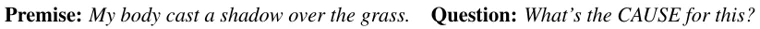
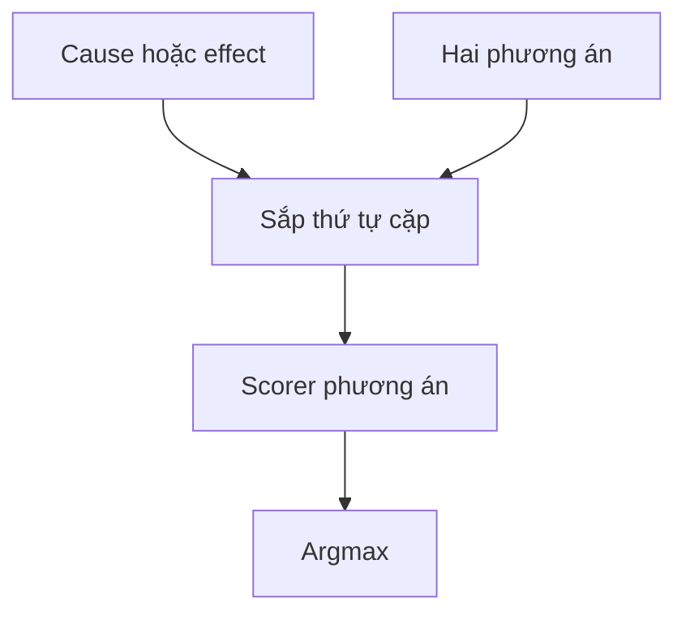

# COPA · Chọn nguyên nhân hoặc hệ quả

Premise, nhãn cause/effect và hai lựa chọn → lựa chọn hợp lý.

**Metric** · Accuracy ↑

**Đề luyện 5 tiếng** · Giữ nguyên các cặp alternatives. Dùng train/dev SuperGLUE COPA, không chỉnh theo test. [Dữ liệu và điều kiện truy cập](https://asgordon.github.io/copa.html).

Cùng một premise, hướng cause/effect quyết định thứ tự so cặp. *Trích Bảng 2, dòng COPA, Wang và cộng sự.* [PDF gốc, trang 4](https://arxiv.org/pdf/1905.00537#page=4).

## Từ baseline đến mô hình mạnh

1. **Baseline.** Cosine premise với mỗi lựa chọn.
2. **Thử nghiệm tiếp theo.** Nhầm chiều nguyên nhân dù đúng chủ đề. Đảo thứ tự cặp văn bản khi câu hỏi hỏi nguyên nhân.
3. **Kiến trúc nghiên cứu.** SuperGLUE COPA dùng mô hình transfer để chấm từng cặp premise/alternative, đo lại trên 100 câu dev.

## Kiến trúc để thử

Khối code có thể tái sử dụng · [Encoder và mask cho batch có padding](../blocks/transformers.py).

## Mốc công bố và hướng SOTA

Bảng 3 của SuperGLUE có cột accuracy COPA và các baseline transfer cùng human estimate. [Thí nghiệm hoặc kiến trúc gốc, tr. 8](https://w4ngatang.github.io/static/papers/superglue.pdf?file=superglue.pdf#page=8).

T5 thống nhất các bài SuperGLUE dưới dạng text-to-text. Đọc điểm theo task và kích thước model, đưa ý tưởng transfer xuống checkpoint nhỏ nếu có. [Paper hoặc bảng đối chiếu](https://hmjianggatech.github.io/files/T5.pdf).

[← Trở về danh sách 30 challenge](../README.md)
