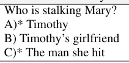
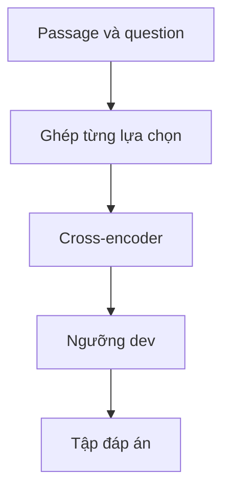

# MultiRC · Chọn nhiều câu trả lời đúng

Đoạn, câu hỏi và nhiều lựa chọn → vector nhị phân.

**Metric** · F1a và exact match theo cả nhóm đáp án ↑

**Đề luyện 5 tiếng** · Chia theo passage, luôn giữ đủ lựa chọn của một câu hỏi. [Dữ liệu và điều kiện truy cập](https://cogcomp.seas.upenn.edu/multirc/).

Các lựa chọn của một câu cùng phụ thuộc vào đoạn dẫn. *Trích Hình 1, câu hỏi và các lựa chọn, Khashabi và cộng sự.* [PDF gốc, trang 2](https://aclanthology.org/N18-1023.pdf#page=2).

## Từ baseline đến mô hình mạnh

1. **Baseline.** BM25 trên đoạn với query gồm question + một lựa chọn.
2. **Thử nghiệm tiếp theo.** F1a tăng nhưng EM thấp khi dư một lựa chọn. Tune ngưỡng chung theo EM, kiểm tra nhóm có ≥2 đáp án.
3. **Kiến trúc nghiên cứu.** SuperGLUE cross-encoder chấm từng đáp án cùng đoạn, thử chia sẻ biểu diễn passage để tiết kiệm.

## Kiến trúc để thử

Khối code có thể tái sử dụng · [Encoder và mask cho batch có padding](../blocks/transformers.py).

## Mốc công bố và hướng SOTA

Bảng 3 của SuperGLUE báo hai metric cho MultiRC. Chỉ đồng nhất khi cả grouping và cách aggregate khớp. [Thí nghiệm hoặc kiến trúc gốc, tr. 8](https://w4ngatang.github.io/static/papers/superglue.pdf?file=superglue.pdf#page=8).

T5 thống nhất các bài SuperGLUE dưới dạng text-to-text. Đọc điểm theo task và kích thước model, đưa ý tưởng transfer xuống checkpoint nhỏ nếu có. [Paper hoặc bảng đối chiếu](https://hmjianggatech.github.io/files/T5.pdf).

[← Trở về danh sách 30 challenge](../README.md)
