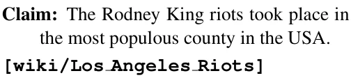
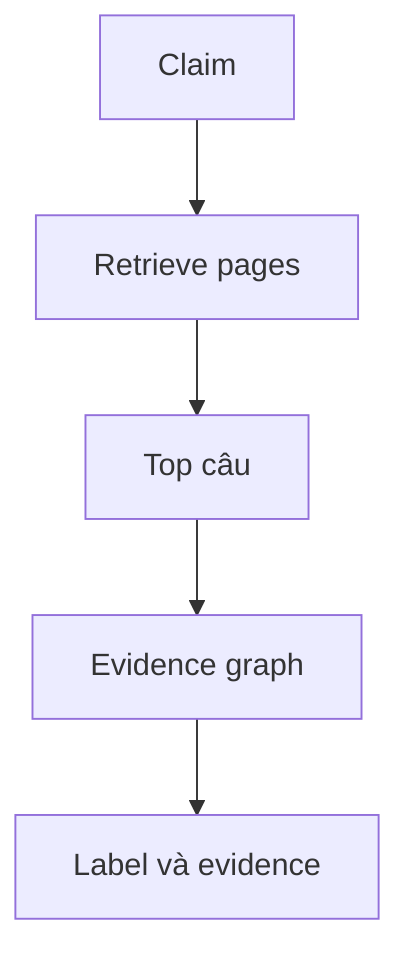

# FEVER · Kiểm chứng bằng chứng

Claim → nhãn và tập evidence sentences.

**Metric** · FEVER score ↑ — đúng nhãn và đủ một evidence set cho claim kiểm chứng được

**Đề luyện 5 tiếng** · Lấy 3.000 claim và một chỉ mục wiki cục bộ, ghi recall của corpus rút gọn. [Dữ liệu và điều kiện truy cập](https://fever.ai/dataset/fever.html).

Điểm FEVER còn phụ thuộc bộ bằng chứng lấy về cho claim. *Trích Hình 1, claim, Thorne và cộng sự.* [PDF gốc, trang 2](https://aclanthology.org/N18-1074.pdf#page=2).

## Từ baseline đến mô hình mạnh

1. **Baseline.** TF-IDF truy hồi page/câu rồi suy nhãn theo overlap.
2. **Thử nghiệm tiếp theo.** Đo recall đủ một evidence set ở top-k. Dùng reranker trước khi tăng độ sâu của verifier.
3. **Kiến trúc nghiên cứu.** GEAR truyền thông tin giữa các câu evidence bằng graph attention trước khi kết luận.

## Kiến trúc để thử

Khối code có thể tái sử dụng · [Ví dụ vector hóa văn bản với TF-IDF](../linear.py).

## Mốc công bố và hướng SOTA

Bảng 5 của GEAR so label accuracy và FEVER score. Khoảng cách giữa hai cột cho biết tác động của evidence. [Thí nghiệm hoặc kiến trúc gốc, tr. 7](https://aclanthology.org/P19-1085.pdf#page=7).

KGAT học trọng số tương tác theo cặp evidence. Cố định top-k câu để đo gain của reasoning graph. [Paper hoặc bảng đối chiếu](https://www.microsoft.com/en-us/research/publication/fine-grained-fact-verification-with-kernel-graph-attention-network/).

[← Trở về danh sách 30 challenge](../README.md)
