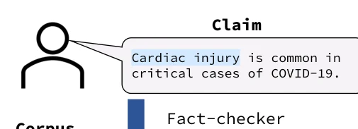
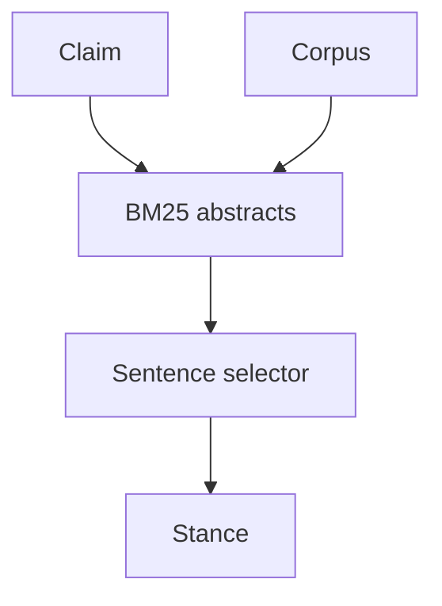

# SciFact · Truy hồi rationale khoa học

Claim + corpus abstract → tài liệu, câu làm bằng chứng và stance.

**Metric** · Sentence-level selection+label F1 ↑ theo scorer SciFact

**Đề luyện 5 tiếng** · Dùng toàn corpus nhỏ, tách theo claim, không đưa cited document IDs vào query. [Dữ liệu và điều kiện truy cập](https://github.com/allenai/scifact).

Tài liệu phải được tìm thấy trước khi chấm stance của claim. *Trích Hình 1, claim và bước truy hồi, Wadden và cộng sự.* [PDF gốc, trang 1](https://aclanthology.org/2020.emnlp-main.609.pdf#page=1).

## Từ baseline đến mô hình mạnh

1. **Baseline.** BM25 theo abstract → câu gần claim nhất → logistic stance.
2. **Thử nghiệm tiếp theo.** So kết quả với oracle abstract. Nếu đúng tài liệu nhưng thiếu phủ định, ghép câu trước/sau vào verifier.
3. **Kiến trúc nghiên cứu.** VeriSci dùng ba bước retrieval, rationale selection và label prediction, có ablation từng bước.

## Kiến trúc để thử

Khối code có thể tái sử dụng · [Ví dụ vector hóa văn bản với TF-IDF](../linear.py).

## Mốc công bố và hướng SOTA

Bảng 4 của VeriSci tách các mức đánh giá. Chọn sentence selection + label khi cần đúng cả câu và stance. [Thí nghiệm hoặc kiến trúc gốc, tr. 7](https://aclanthology.org/2020.emnlp-main.609.pdf#page=7).

MultiVerS dùng full-document context và dự đoán rationale cùng veracity. Thử ablation cắt context về đúng một câu. [Paper hoặc bảng đối chiếu](https://aclanthology.org/2022.findings-naacl.6/).

[← Trở về danh sách 30 challenge](../README.md)
