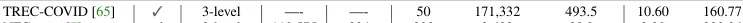
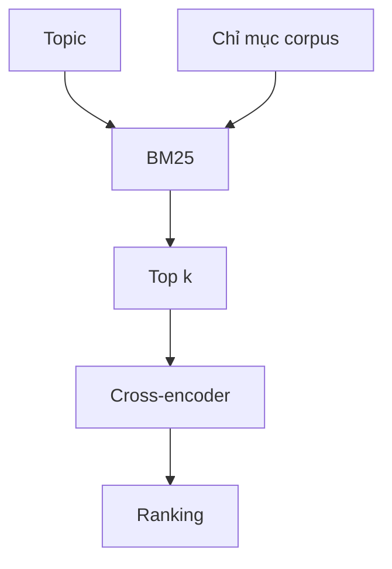

# TREC-COVID · Xếp hạng tài liệu

Topic → danh sách ID bài báo. Chỉ dùng văn bản truy hồi.

**Metric** · nDCG@10 ↑

**Đề luyện 5 tiếng** · Chọn một round, cố định corpus và qrels cùng round, chia dev theo topic. [Dữ liệu và điều kiện truy cập](https://ir.nist.gov/covidSubmit/).

Corpus và qrels của một round quyết định tập tài liệu có thể được chấm. *Trích Bảng 1 của BEIR, hàng TREC-COVID, Thakur và cộng sự.* [PDF gốc, trang 4](https://arxiv.org/pdf/2104.08663#page=4).

## Từ baseline đến mô hình mạnh

1. **Baseline.** BM25 title + abstract.
2. **Thử nghiệm tiếp theo.** Phân tích topic thiếu từ đồng nghĩa. So query expansion với rerank top 50 bằng cross-encoder.
3. **Kiến trúc nghiên cứu.** BEIR so các họ lexical, dense và reranking trên TREC-COVID, đối chiếu đúng phiên bản qrels.

## Kiến trúc để thử

Khối code có thể tái sử dụng · [Ví dụ vector hóa văn bản với TF-IDF](../linear.py).

## Mốc công bố và hướng SOTA

Bảng 2 BEIR dùng nDCG@10 trên corpus TREC-COVID của BEIR, ghi rõ qrels nếu dùng một round gốc của NIST. [Thí nghiệm hoặc kiến trúc gốc, tr. 7](https://arxiv.org/pdf/2104.08663#page=7).

ColBERTv2 giữ token vectors cho late interaction. Bắt đầu bằng rerank top 100 đã cache rồi mới đo chi phí xây index toàn corpus. [Paper hoặc bảng đối chiếu](https://aclanthology.org/2022.naacl-main.272/).

[← Trở về danh sách 30 challenge](../README.md)
