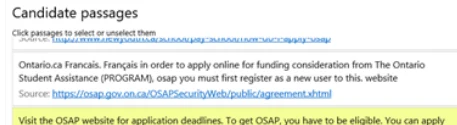
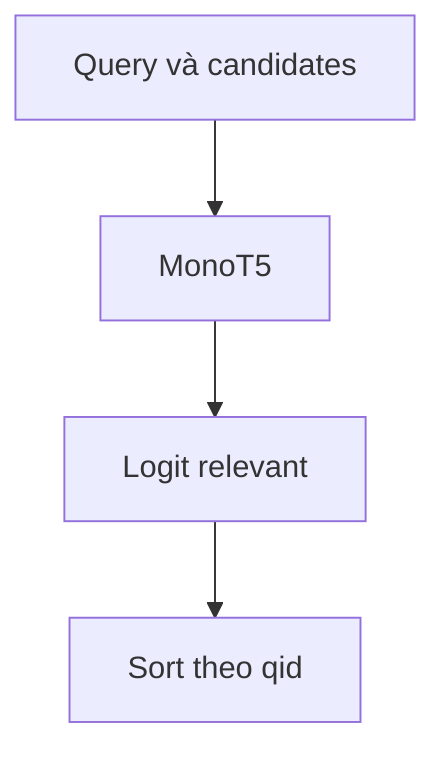

# MS MARCO · Passage reranking

Query + danh sách passage ứng viên → thứ tự passage ID.

**Metric** · MRR@10 ↑

**Đề luyện 5 tiếng** · Dùng top 100 từ một run cố định và 3.000 query có qrels, chia theo qid. [Dữ liệu và điều kiện truy cập](https://microsoft.github.io/msmarco/Datasets.html).

Một query có nhiều passage ứng viên, rank đầu đúng chi phối MRR. *Trích Hình 1, giao diện chọn passage, Nguyen và cộng sự.* [PDF gốc, trang 4](https://arxiv.org/pdf/1611.09268#page=4).

## Từ baseline đến mô hình mạnh

1. **Baseline.** BM25 trên passage trong candidate pool.
2. **Thử nghiệm tiếp theo.** Đo oracle MRR của pool, sau đó train pairwise với negative xếp cao nhưng không liên quan.
3. **Kiến trúc nghiên cứu.** MonoT5 sinh xác suất nhãn liên quan cho mỗi query–passage, chỉ rerank top-k trong buổi thi.

## Kiến trúc để thử

Khối code có thể tái sử dụng · [Ví dụ vector hóa văn bản với TF-IDF](../linear.py).

## Mốc công bố và hướng SOTA

Bảng 1 MonoT5 so MRR@10 qua kích thước model và các bộ candidate. Recall của pool đặt trần cho reranker. [Thí nghiệm hoặc kiến trúc gốc, tr. 4](https://aclanthology.org/2020.findings-emnlp.63.pdf#page=4).

ColBERTv2 giữ token vectors cho late interaction. Bắt đầu bằng rerank top 100 đã cache rồi mới đo chi phí xây index toàn corpus. [Paper hoặc bảng đối chiếu](https://aclanthology.org/2022.naacl-main.272/).

[← Trở về danh sách 30 challenge](../README.md)
