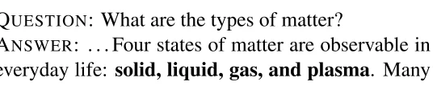
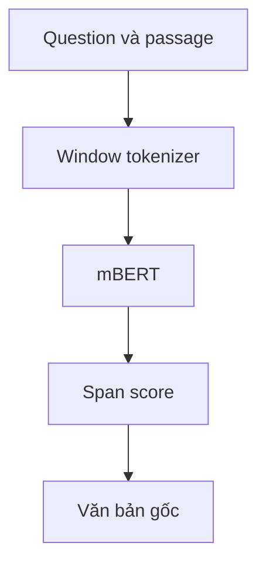

# TyDi QA GoldP · Span đa ngôn ngữ

Câu hỏi + gold passage → span ngắn.

**Metric** · EM, token F1 ↑ theo ngôn ngữ trên GoldP

**Đề luyện 5 tiếng** · Chọn hai ngôn ngữ trong GoldP. Lưu offset trên đúng chuỗi Unicode của bản đã chuyển đổi. [Dữ liệu và điều kiện truy cập](https://github.com/google-research-datasets/tydiqa).

Từ câu hỏi, reader phải tìm đáp án trong văn bản cùng ngôn ngữ. *Trích Hình 1, phần đầu ví dụ, Clark và cộng sự.* [PDF gốc, trang 2](https://aclanthology.org/2020.tacl-1.30.pdf#page=2).

## Từ baseline đến mô hình mạnh

1. **Baseline.** Chọn câu gần câu hỏi nhất, lấy cụm tên hoặc số.
2. **Thử nghiệm tiếp theo.** So hai ngôn ngữ sau khi chấm bằng evaluator cùng bản, tăng stride nếu đáp án rơi ngoài window.
3. **Kiến trúc nghiên cứu.** TyDi QA dùng multilingual BERT để học ranh giới, so chênh lệch theo ngôn ngữ và độ dài passage.

## Kiến trúc để thử

Khối code có thể tái sử dụng · [Encoder và mask cho batch có padding](../blocks/transformers.py).

## Mốc công bố và hướng SOTA

Mục 8.2, Bảng 7 công bố F1 cho GoldP. Primary task ở Bảng 5 đòi chọn passage nên có điều kiện khác. [Thí nghiệm hoặc kiến trúc gốc, tr. 12](https://aclanthology.org/2020.tacl-1.30.pdf#page=12).

CANINE mã hóa ở mức ký tự. So theo ngôn ngữ và sự thay đổi độ dài input, giữ rõ Primary và GoldP. [Paper hoặc bảng đối chiếu](https://aclanthology.org/2022.tacl-1.5/).

[← Trở về danh sách 30 challenge](../README.md)
