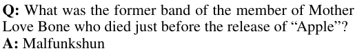
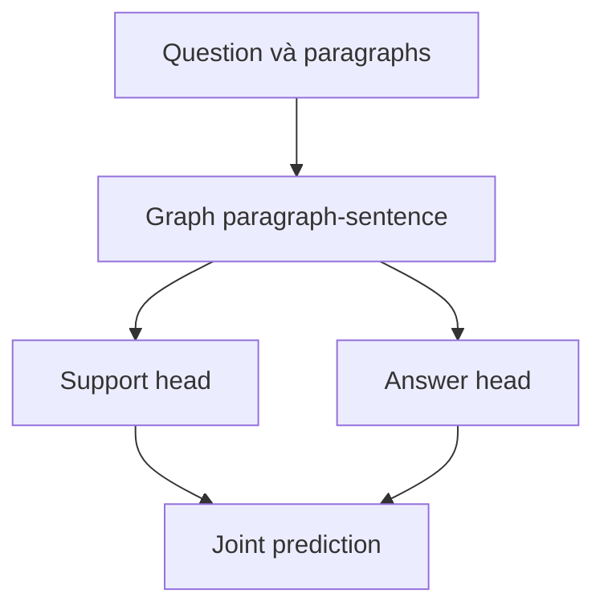

# HotpotQA · Đọc hai bằng chứng

Question + distractor paragraphs → đáp án và cặp (title, sentence id).

**Metric** · Joint F1 ↑

**Đề luyện 5 tiếng** · Dùng distractor setting, lấy 2.000 ví dụ nhưng giữ tất cả đoạn của mỗi câu. [Dữ liệu và điều kiện truy cập](https://hotpotqa.github.io/).

Thử truy ngược hai câu bằng chứng cần để nối tên riêng trong query với đáp án. *Trích Hình 1, câu hỏi và đáp án, Yang và cộng sự.* [PDF gốc, trang 1](https://aclanthology.org/D18-1259.pdf#page=1).

## Từ baseline đến mô hình mạnh

1. **Baseline.** Xếp từng câu theo overlap, lấy hai câu và trích span.
2. **Thử nghiệm tiếp theo.** Lỗi bridge thường do câu thứ hai không chứa từ hỏi. Ghép entity từ câu đầu vào truy vấn lần hai.
3. **Kiến trúc nghiên cứu.** Hierarchical Graph Network truyền thông tin qua graph paragraph–sentence–entity, đối chiếu answer F1 và support F1.

## Kiến trúc để thử

Khối code có thể tái sử dụng · [Encoder và mask cho batch có padding](../blocks/transformers.py).

## Mốc công bố và hướng SOTA

Bảng 1 của HGN là distractor test, có cột answer, supporting fact và joint. Fullwiki được báo riêng ở Bảng 2. [Thí nghiệm hoặc kiến trúc gốc, tr. 6](https://aclanthology.org/2020.emnlp-main.710.pdf#page=6).

Longformer kết hợp local và global attention cho văn bản dài. Đặt global attention lên question và so chi phí theo số đoạn. [Paper hoặc bảng đối chiếu](https://arxiv.org/abs/2004.05150).

[← Trở về danh sách 30 challenge](../README.md)
