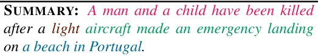
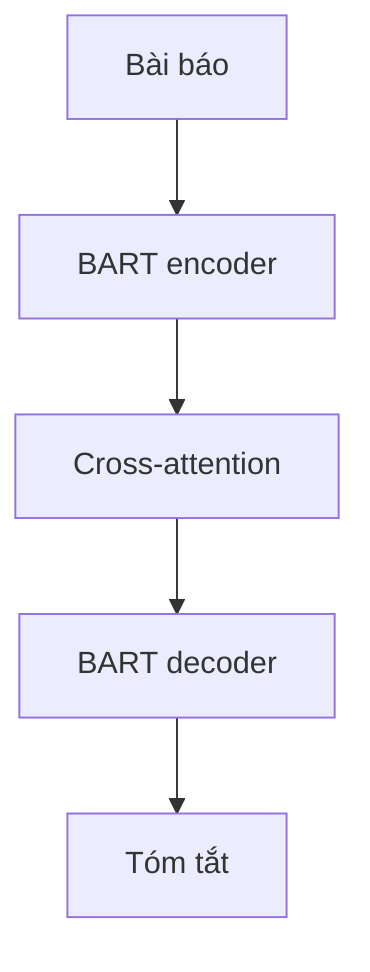

# XSum · Tóm tắt một câu

Bài báo → tóm tắt một câu.

**Metric** · ROUGE-1/2/L ↑

**Đề luyện 5 tiếng** · Chọn 3.000 bài ngắn, giữ split gốc, giới hạn độ dài nguồn và đo tỉ lệ bị cắt. [Dữ liệu và điều kiện truy cập](https://github.com/EdinburghNLP/XSum).

Đích là một câu mang thông tin chính từ toàn bài. *Trích Hình 1, câu tóm tắt, Narayan, Cohen & Lapata.* [PDF gốc, trang 1](https://aclanthology.org/D18-1206.pdf#page=1).

## Từ baseline đến mô hình mạnh

1. **Baseline.** Lead-1 lấy câu đầu của bài.
2. **Thử nghiệm tiếp theo.** Đo trùng từ và thực thể mới. So chọn câu trung tâm với BART nhỏ fine-tune có checkpoint sẵn.
3. **Kiến trúc nghiên cứu.** BART encoder–decoder học khử nhiễu trước huấn luyện, chỉnh length penalty trên dev.

## Kiến trúc để thử

Khối code có thể tái sử dụng · [Khối tự hồi quy và cách dịch nhãn một token](../blocks/transformers.py).

## Mốc công bố và hướng SOTA

Bảng 4 BART đặt XSum cạnh CNN/DailyMail, đọc ba cột ROUGE phía XSum. [Thí nghiệm hoặc kiến trúc gốc, tr. 7](https://aclanthology.org/2020.acl-main.703.pdf#page=7).

PEGASUS dùng gap-sentence generation gắn với summarization. So ROUGE của từng model trên XSum và kiểm tra tên riêng sinh thêm. [Paper hoặc bảng đối chiếu](https://research.google/pubs/pegasus-pretraining-with-extracted-gap-sentences-for-abstractive-summarization-by-sequence-to-sequence-models/).

[← Trở về danh sách 30 challenge](../README.md)
