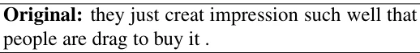
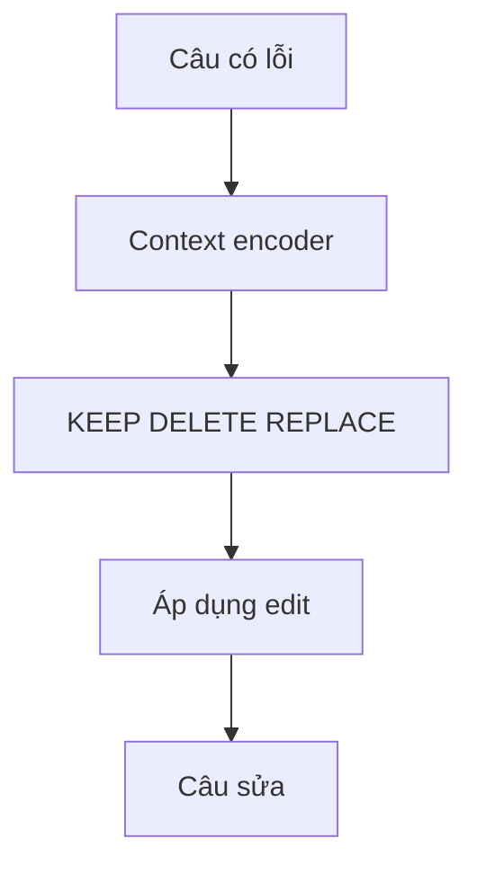

# JFLEG · Sửa câu cho tự nhiên

Câu tiếng Anh có lỗi → câu đã sửa.

**Metric** · GLEU ↑ theo script JFLEG, nhiều reference

**Đề luyện 5 tiếng** · Dùng dev để chỉnh quy tắc, JFLEG chỉ cung cấp dev/test. Nếu học, dùng dữ liệu train GEC được phép từ trước. [Dữ liệu và điều kiện truy cập](https://github.com/keisks/jfleg).

So một câu nguồn với nhiều reference giúp ghi nhận các cách sửa chấp nhận được. *Trích Bảng 1, dòng đầu câu gốc, Napoles và cộng sự.* [PDF gốc, trang 1](https://aclanthology.org/E17-2037.pdf#page=1).

## Từ baseline đến mô hình mạnh

1. **Baseline.** Copy nguyên câu rồi thêm một bộ quy tắc về viết hoa và khoảng trắng.
2. **Thử nghiệm tiếp theo.** Đếm sửa nhầm trên câu vốn đúng. Học thao tác KEEP/DELETE/REPLACE và tune ngưỡng sửa.
3. **Kiến trúc nghiên cứu.** GECToR giải GEC bằng sequence tagging, giảm số bước so với giải mã tự hồi quy.

## Kiến trúc để thử

Khối code có thể tái sử dụng · [Khối tự hồi quy và cách dịch nhãn một token](../blocks/transformers.py).

## Mốc công bố và hướng SOTA

GECToR báo F0.5 trên benchmark GEC trong paper. Khi chuyển sang JFLEG, chạy GLEU với toàn bộ reference theo từng câu. [Thí nghiệm hoặc kiến trúc gốc, tr. 4](https://aclanthology.org/2020.bea-1.16.pdf#page=4).

Đối chiếu hướng sinh cặp câu sai–đúng bằng dữ liệu tổng hợp. Kết quả JFLEG dùng GLEU nhiều reference. [Paper hoặc bảng đối chiếu](https://research.google/pubs/corpora-generation-for-grammatical-error-correction/).

[← Trở về danh sách 30 challenge](../README.md)
