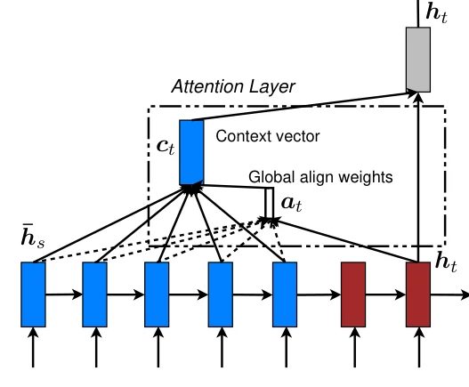
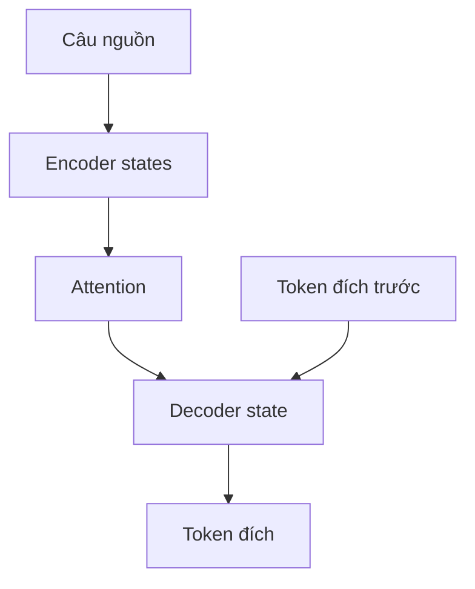

# IWSLT Anh–Việt · Dịch câu TED

Câu tiếng Anh → bản dịch tiếng Việt.

**Metric** · SacreBLEU ↑, lưu signature cho bài rút gọn

**Đề luyện 5 tiếng** · Dùng corpus Stanford IWSLT15 en-vi, tst2012 dev và tst2013 test, lấy 10.000 cặp train. [Dữ liệu và điều kiện truy cập](https://nlp.stanford.edu/projects/nmt/).

Một bước decoder có thể đặt trọng số lên nhiều vị trí câu nguồn. *Trích Hình 2, global attention, Luong, Pham & Manning.* [PDF gốc, trang 3](https://aclanthology.org/D15-1166.pdf#page=3).

## Từ baseline đến mô hình mạnh

1. **Baseline.** Word table theo đồng xuất hiện, dịch từng từ phổ biến nhất.
2. **Thử nghiệm tiếp theo.** BLEU thấp ở cụm đảo trật tự. Học BPE trên train, train encoder–decoder nhỏ có attention và mask padding.
3. **Kiến trúc nghiên cứu.** Luong attention cho decoder đọc trạng thái nguồn theo từng bước, thử beam nhỏ với length penalty.

## Kiến trúc để thử

Khối code có thể tái sử dụng · [Khối tự hồi quy và cách dịch nhãn một token](../blocks/transformers.py).

## Mốc công bố và hướng SOTA

Luong attention báo WMT Anh–Đức trong paper. Để so Anh–Việt, dùng cùng tst2013, detokenization và signature BLEU. [Thí nghiệm hoặc kiến trúc gốc, tr. 6](https://aclanthology.org/D15-1166.pdf#page=6).

Hệ Stanford là mốc trực tiếp cho dịch Anh–Việt TED. Ghi rõ bộ tokenization khi so điểm BLEU công bố. [Paper hoặc bảng đối chiếu](https://aclanthology.org/2015.iwslt-evaluation.11/).

[← Trở về danh sách 30 challenge](../README.md)
