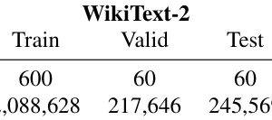
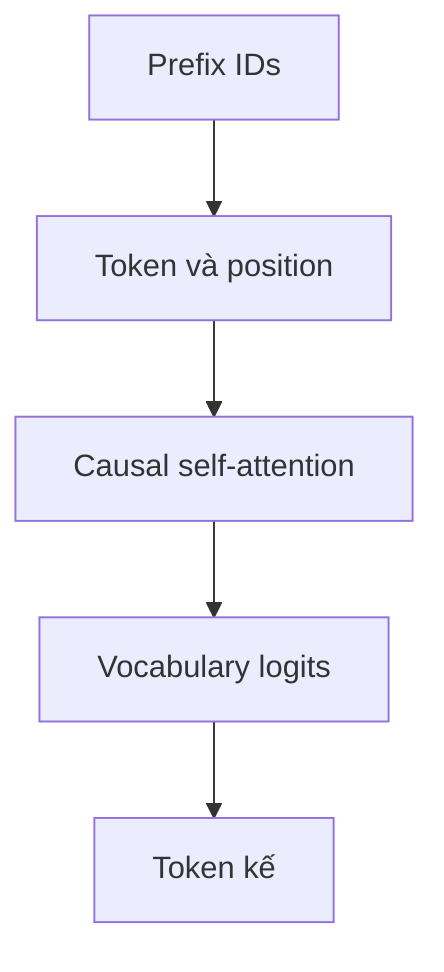

# WikiText-2 · Mô hình ngôn ngữ causal

Prefix → phân bố token kế tiếp.

**Metric** · Perplexity ↓, chỉ so khi cùng tokenizer, vocab và cách đếm EOS

**Đề luyện 5 tiếng** · Lấy raw split, chia theo article trước khi cắt block, giữ EOS giữa bài và mask pad. [Dữ liệu và điều kiện truy cập](https://huggingface.co/datasets/Salesforce/wikitext).

Giữ nguyên bản corpus, tokenizer và cách tính OOV khi so perplexity. *Trích Bảng 1, tên bản corpus, Merity và cộng sự.* [PDF gốc, trang 5](https://arxiv.org/pdf/1609.07843#page=5).

## Từ baseline đến mô hình mạnh

1. **Baseline.** Bigram add-k với vocab từ train.
2. **Thử nghiệm tiếp theo.** So NLL theo độ dài ngữ cảnh. Decoder causal dùng block 128, shift nhãn đúng một token.
3. **Kiến trúc nghiên cứu.** Transformer-XL tái sử dụng hidden states giữa các segment, paper có các benchmark LM, kiểm tra lại trên WikiText-2.

## Kiến trúc để thử

Khối code có thể tái sử dụng · [Khối tự hồi quy và cách dịch nhãn một token](../blocks/transformers.py).

## Mốc công bố và hướng SOTA

Transformer-XL báo WikiText-103 trong Bảng 1. WikiText-2 cần đo lại và ghi rõ word-level hoặc subword-level perplexity. [Thí nghiệm hoặc kiến trúc gốc, tr. 6](https://aclanthology.org/P19-1285.pdf#page=6).

Mixture of Softmaxes tăng khả năng biểu diễn phân bố token. Đọc WikiText-2 word-level trước khi so với BPE causal LM. [Paper hoặc bảng đối chiếu](https://arxiv.org/abs/1711.03953).

[← Trở về danh sách 30 challenge](../README.md)
