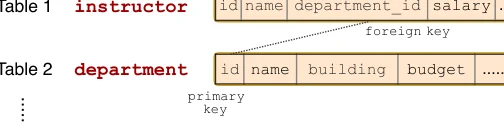
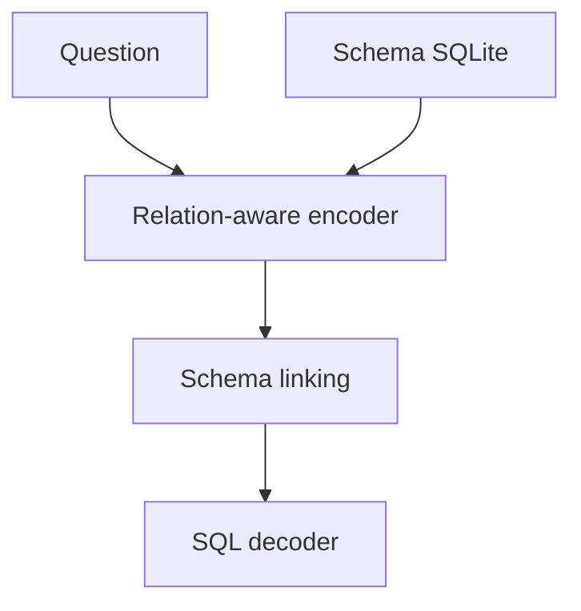

# Spider · Sinh SQL từ schema

Question + schema SQLite → câu SELECT.

**Metric** · Execution accuracy ↑ trong bài luyện, benchmark có evaluator riêng

**Đề luyện 5 tiếng** · Chọn single-table SELECT/WHERE, chia theo database ID. Chỉ chạy câu đọc trên bản DB local. [Dữ liệu và điều kiện truy cập](https://yale-lily.github.io/spider).

Các trường trên hai bảng có thể trùng tên; cần xét khóa liên kết. *Trích Hình 1, schema, Yu và cộng sự.* [PDF gốc, trang 1](https://aclanthology.org/D18-1425.pdf#page=1).

## Từ baseline đến mô hình mạnh

1. **Baseline.** Chọn cột theo overlap, ráp SELECT/WHERE từ template.
2. **Thử nghiệm tiếp theo.** Sai tên cột làm SQL hợp cú pháp nhưng sai kết quả. Thêm liên kết từ câu hỏi tới schema và decoding có ràng buộc.
3. **Kiến trúc nghiên cứu.** RAT-SQL biểu diễn quan hệ giữa bảng, cột, token bằng attention có kiểu cạnh.

## Kiến trúc để thử

Khối code có thể tái sử dụng · [Khối tự hồi quy và cách dịch nhãn một token](../blocks/transformers.py).

## Mốc công bố và hướng SOTA

Bảng 2 RAT-SQL dùng exact set match trên Spider. Execution accuracy của bài single-table cần chấm riêng. [Thí nghiệm hoặc kiến trúc gốc, tr. 7](https://aclanthology.org/2020.acl-main.677.pdf#page=7).

PICARD ràng buộc incremental decoding theo cú pháp SQL. Chạy ablation số output invalid và execution accuracy để thấy tác động. [Paper hoặc bảng đối chiếu](https://aclanthology.org/2021.emnlp-main.779/).

[← Trở về danh sách 30 challenge](../README.md)
