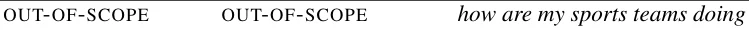
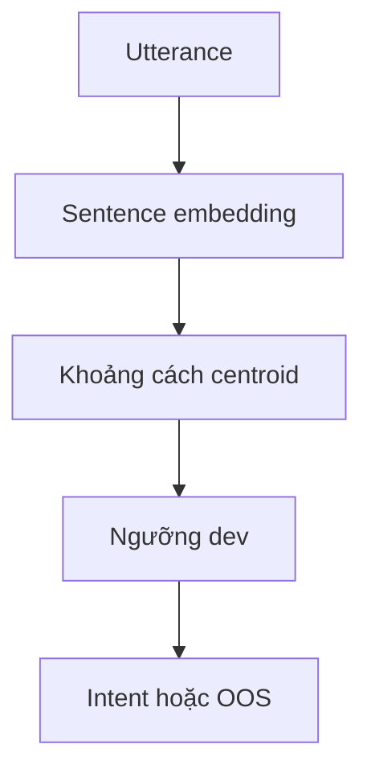

# CLINC150 · Từ chối yêu cầu ngoài miền

Câu nói → intent đã biết hoặc out-of-scope.

**Metric** · In-scope accuracy và OOS recall ↑

**Đề luyện 5 tiếng** · Dùng phần OOS dev để chọn ngưỡng, báo cả false reject trên in-scope. [Dữ liệu và điều kiện truy cập](https://github.com/clinc/oos-eval).

Câu OOS vẫn có cú pháp của một yêu cầu hợp lệ. *Trích Bảng 1, một câu ngoài miền, Larson và cộng sự.* [PDF gốc, trang 3](https://aclanthology.org/D19-1131.pdf#page=3).

## Từ baseline đến mô hình mạnh

1. **Baseline.** TF-IDF nearest centroid, reject nếu max cosine dưới ngưỡng.
2. **Thử nghiệm tiếp theo.** Vẽ phân bố khoảng cách cho OOS và hai intent sát nhau. So ngưỡng toàn cục với khoảng cách tới centroid gần nhì.
3. **Kiến trúc nghiên cứu.** CLINC150 đánh giá mô hình intent kèm OOS detection, đối chiếu cùng chế độ số mẫu OOS train.

## Kiến trúc để thử

Khối code có thể tái sử dụng · [FeatureUnion cho word/char n-grams và linear classifier](../linear.py).

## Mốc công bố và hướng SOTA

Bảng 2 tách accuracy intent và recall ngoài miền theo chế độ full/small/imbalanced, giữ đúng số mẫu OOS train. [Thí nghiệm hoặc kiến trúc gốc, tr. 4](https://aclanthology.org/D19-1131.pdf#page=4).

SetFit học embedding câu bằng các cặp contrastive rồi fit classifier. Với intent mới, chốt trước số mẫu mỗi lớp, với OOS, chọn ngưỡng bằng dev ngoài miền. [Paper hoặc bảng đối chiếu](https://arxiv.org/abs/2209.11055).

[← Trở về danh sách 30 challenge](../README.md)
