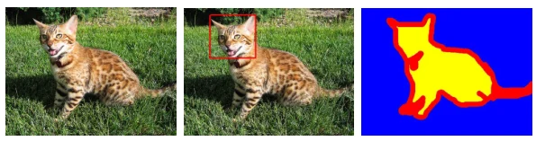
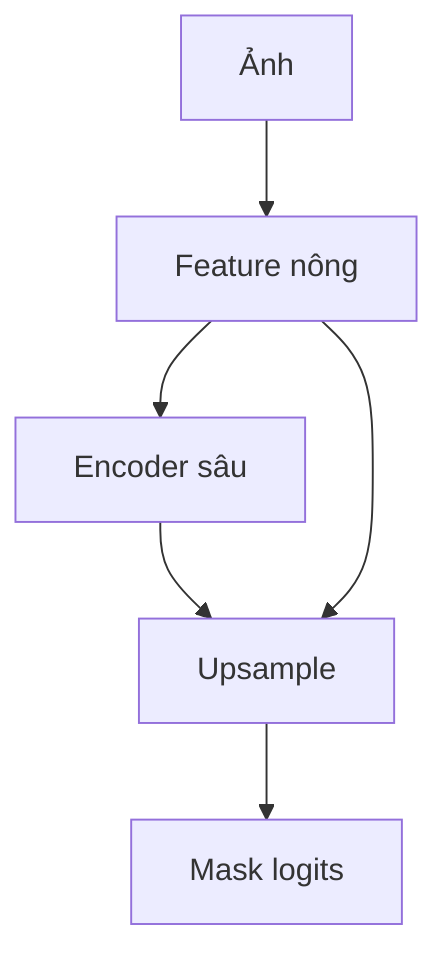

# Oxford-IIIT Pet · Tách thú cưng khỏi nền

Ảnh RGB + trimap → mask foreground, background, border.

**Metric** · mIoU 3 lớp ↑ cho bài luyện

**Đề luyện 5 tiếng** · Chia từ trainval theo ảnh, train 1.500 ảnh ở 160². Mapping gốc 1=pet, 2=background, 3=border. [Dữ liệu và điều kiện truy cập](https://www.robots.ox.ac.uk/~vgg/data/pets/).

Ảnh, hộp vùng đầu và trimap là ba dạng supervision đi kèm cùng một mẫu. *Trích Hình 1, hàng trên, Parkhi và cộng sự.* [PDF gốc, trang 2](https://www.robots.ox.ac.uk/~vgg/publications/2012/parkhi12a/parkhi12a.pdf#page=2).

## Từ baseline đến mô hình mạnh

1. **Baseline.** CNN encoder giảm 4 lần, bilinear upsample logits về cỡ ảnh.
2. **Thử nghiệm tiếp theo.** Lỗi tập trung ở tai và râu. Ghép skip feature độ phân giải cao, đo riêng IoU lớp border và so CE với CE + Dice.
3. **Kiến trúc nghiên cứu.** U-Net nối skip cùng độ phân giải giúp khôi phục chi tiết biên, giữ resize mask bằng nearest.

## Kiến trúc để thử

Khối code có thể tái sử dụng · [Loader ảnh và target pixel với hình học đồng bộ](../blocks/masks.py).

## Mốc công bố và hướng SOTA

U-Net công bố trên bài segmentation y sinh. Bài thú cưng có ba lớp và trimap riêng nên cần tính lại mIoU. [Thí nghiệm hoặc kiến trúc gốc, tr. 6](https://arxiv.org/pdf/1505.04597#page=6).

Mask2Former cho các mask queries tập trung vào vùng pixel dự đoán. Khi chuyển sang subset, so ảnh hưởng của mask loss trên lớp nhỏ với FCN cùng backbone. [Paper hoặc bảng đối chiếu](https://openaccess.thecvf.com/content/CVPR2022/html/Cheng_Masked-Attention_Mask_Transformer_for_Universal_Image_Segmentation_CVPR_2022_paper.html).

[← Trở về danh sách 30 challenge](../README.md)
