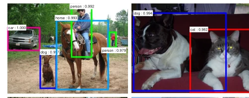
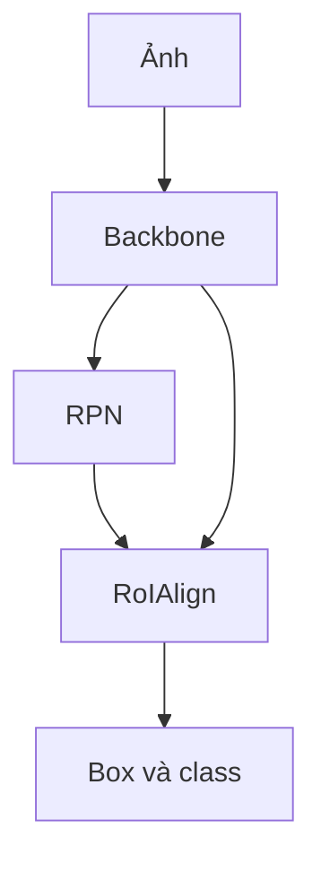

# VOC 2007 · Detection nhiều lớp

Ảnh + XML chứa xmin/ymin/xmax/ymax → boxes, classes, scores.

**Metric** · VOC07 11-point mAP@0.5 ↑

**Đề luyện 5 tiếng** · Dùng trainval/test, chọn 3 lớp cho buổi luyện, giữ ảnh âm. Đổi tọa độ 1-based inclusive sang 0-based half-open ngay khi đọc. [Dữ liệu và điều kiện truy cập](https://www.robots.ox.ac.uk/~vgg/projects/pascal/VOC/voc2007/).

Nhiều proposal có thể phủ cùng một vật; ROI head cần phân loại và chỉnh hộp. *Trích Hình 3, phần proposal, Ren và cộng sự.* [PDF gốc, trang 4](https://arxiv.org/pdf/1506.01497#page=4).

## Từ baseline đến mô hình mạnh

1. **Baseline.** Với từng ảnh chấm objectness và offset box theo cell trên feature map.
2. **Thử nghiệm tiếp theo.** So recall theo kích thước vật và vẽ lại box sau resize/flip. Nếu nhiều vật chung cell, chuyển sang multi-scale detector.
3. **Kiến trúc nghiên cứu.** Faster R-CNN sinh proposal bằng RPN rồi phân lớp ROI. So cùng backbone và cùng cách xử lý difficult.

## Kiến trúc để thử

Khối code có thể tái sử dụng · [Đọc box, đổi format, resize và flip ảnh–box](../blocks/data.py).

## Mốc công bố và hướng SOTA

Bảng 3 Faster R-CNN so các cấu hình trên VOC 2007 test, xem cột training data trước khi so mAP. [Thí nghiệm hoặc kiến trúc gốc, tr. 8](https://arxiv.org/pdf/1506.01497#page=8).

Đối chiếu AP từng lớp trong kết quả challenge VOC, đặc biệt điều kiện train thêm dữ liệu và quy tắc difficult. [Paper hoặc bảng đối chiếu](https://www.robots.ox.ac.uk/~vgg/projects/pascal/VOC/voc2007/results/index.shtml).

[← Trở về danh sách 30 challenge](../README.md)
