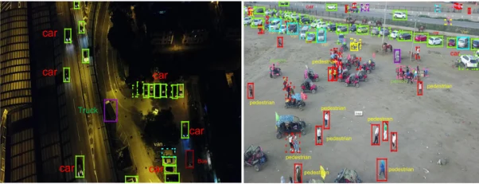
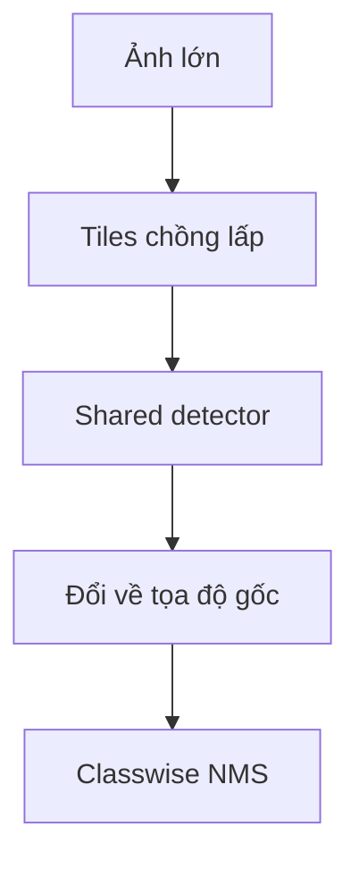

# VisDrone-DET · Vật thể nhỏ trong ảnh UAV

Ảnh + dòng xywh, score, category, truncation, occlusion → nhiều bbox.

**Metric** · AP@[.50:.95] ↑ theo evaluator VisDrone

**Đề luyện 5 tiếng** · Chọn 1.500 ảnh, chia theo sequence nếu lấy từ video, giữ vùng ignore trong evaluator. [Dữ liệu và điều kiện truy cập](https://github.com/VisDrone/VisDrone-Dataset).

Đo cạnh ngắn của box sau resize; khi chỉ còn vài pixel, thử tile trước khi đổi backbone. *Trích Hình 1, một phần hàng trên, Zhu và cộng sự.* [PDF gốc, trang 4](https://arxiv.org/pdf/2001.06303#page=4).

## Từ baseline đến mô hình mạnh

1. **Baseline.** Resize ảnh nguyên khung, detector một tầng.
2. **Thử nghiệm tiếp theo.** Đo recall theo chiều cao bbox sau resize. Cắt tile chồng mép, dịch box về hệ ảnh rồi gộp bằng NMS theo lớp.
3. **Kiến trúc nghiên cứu.** SAHI dùng slicing ở cả fine-tuning và inference, ablate tile size với cùng ngân sách pixel.

## Kiến trúc để thử

Khối code có thể tái sử dụng · [Đọc box, đổi format, resize và flip ảnh–box](../blocks/data.py).

## Mốc công bố và hướng SOTA

Bảng 1, VisDrone19-DET val. FCOS full-image đạt 25,8 AP, kết hợp SAHI + full-image + postprocess đạt 31,0 AP trong cùng bảng. [Thí nghiệm hoặc kiến trúc gốc, tr. 3](https://arxiv.org/pdf/2202.06934#page=3).

Xem báo cáo challenge với hệ dẫn đầu, policy multi-scale và ensemble. Chỉ giữ bước có lợi trên chính các hộp nhỏ của dev. [Paper hoặc bảng đối chiếu](https://openaccess.thecvf.com/content_ICCVW_2019/html/VISDrone/Du_VisDrone-DET2019_The_Vision_Meets_Drone_Object_Detection_in_Image_Challenge_ICCVW_2019_paper.html).

[← Trở về danh sách 30 challenge](../README.md)
