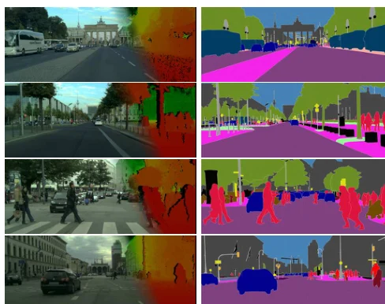
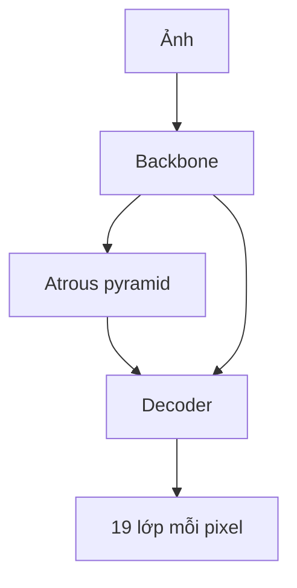

# Cityscapes · Semantic segmentation đường phố

RGB → class trainId cho từng pixel.

**Metric** · mIoU 19 lớp ↑, bỏ void 255

**Đề luyện 5 tiếng** · Dùng fine annotations, chọn hai thành phố train, giữ dev khác thành phố, crop 256×512. [Dữ liệu và điều kiện truy cập](https://www.cityscapes-dataset.com/).

So mask theo lớp nhỏ như người hoặc cột thay vì chỉ nhìn phần mặt đường. *Trích Hình 5, lát kết quả, Cordts và cộng sự.* [PDF gốc, trang 8](https://openaccess.thecvf.com/content_cvpr_2016/papers/Cordts_The_Cityscapes_Dataset_CVPR_2016_paper.pdf#page=8).

## Từ baseline đến mô hình mạnh

1. **Baseline.** FCN nhẹ + cross-entropy ignore_index=255.
2. **Thử nghiệm tiếp theo.** Đo IoU cột, người và biển báo. Thêm decoder stride 4 hoặc atrous context, rồi so từng lớp.
3. **Kiến trúc nghiên cứu.** DeepLabv3+ dùng ASPP và decoder ghép feature mức thấp để cải thiện ranh giới.

## Kiến trúc để thử

Khối code có thể tái sử dụng · [Loader ảnh và target pixel với hình học đồng bộ](../blocks/masks.py).

## Mốc công bố và hướng SOTA

DeepLabv3+ có thí nghiệm Cityscapes. Kiểm tra fine/coarse labels, output stride và multiscale inference khi so kết quả. [Thí nghiệm hoặc kiến trúc gốc, tr. 13](https://arxiv.org/pdf/1802.02611#page=13).

Mask2Former cho các mask queries tập trung vào vùng pixel dự đoán. Khi chuyển sang subset, so ảnh hưởng của mask loss trên lớp nhỏ với FCN cùng backbone. [Paper hoặc bảng đối chiếu](https://openaccess.thecvf.com/content/CVPR2022/html/Cheng_Masked-Attention_Mask_Transformer_for_Universal_Image_Segmentation_CVPR_2022_paper.html).

[← Trở về danh sách 30 challenge](../README.md)
