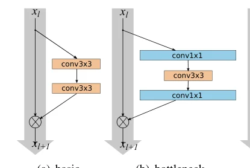
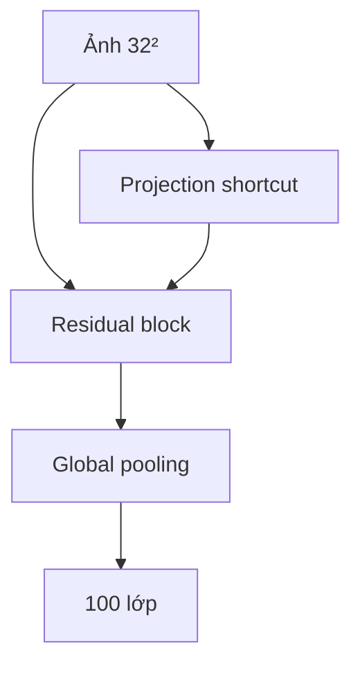

# CIFAR-100 · Phân loại ảnh nhỏ

Ảnh RGB 32² → một trong 100 fine labels.

**Metric** · Top-1 accuracy ↑

**Đề luyện 5 tiếng** · Chia stratified 90/10 từ train, giữ test cuối buổi, không upscale trong baseline. [Dữ liệu và điều kiện truy cập](https://www.cs.toronto.edu/~kriz/cifar.html).

Shortcut giữ đường truyền trực tiếp khi thêm convolution vào backbone ảnh nhỏ. *Trích Hình 1, hai block residual, Zagoruyko & Komodakis.* [PDF gốc, trang 2](https://arxiv.org/pdf/1605.07146#page=2).

## Từ baseline đến mô hình mạnh

1. **Baseline.** CNN ba block, global mean, linear head.
2. **Thử nghiệm tiếp theo.** Train tốt nhưng dev kém. Thử crop có padding + flip, sau đó residual shortcut, so cùng số epoch.
3. **Kiến trúc nghiên cứu.** Wide ResNet tăng chiều rộng block, có thực nghiệm trên CIFAR-100, đo thêm số tham số.

## Kiến trúc để thử

Khối code có thể tái sử dụng · [Conv blocks và feature maps](../blocks/models.py).

## Mốc công bố và hướng SOTA

Wide Residual Networks báo CIFAR-100 với nhiều độ rộng. Tách kết quả dùng ZCA/gcn và preprocessing thông thường. [Thí nghiệm hoặc kiến trúc gốc, tr. 8](https://arxiv.org/pdf/1605.07146#page=8).

ShakeDrop làm nhiễu residual branch khi train. So với WideResNet cùng số tham số, augmentation và epochs. [Paper hoặc bảng đối chiếu](https://arxiv.org/abs/1802.02375).

[← Trở về danh sách 30 challenge](../README.md)
