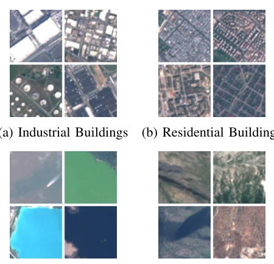
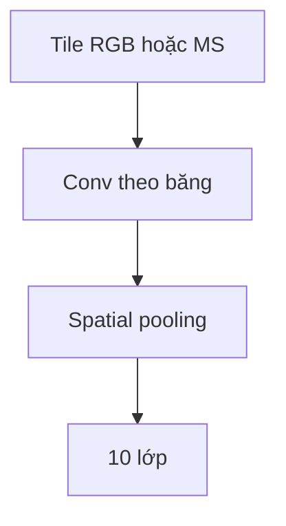

# EuroSAT · Lớp phủ bề mặt qua RGB

Tile Sentinel-2 → một trong 10 lớp đất.

**Metric** · Accuracy và macro-F1 ↑ cho bài luyện

**Đề luyện 5 tiếng** · Lấy 400 ảnh/lớp, group theo vị trí nếu có tọa độ, nếu chỉ có JPEG thì công bố stratified split. [Dữ liệu và điều kiện truy cập](https://github.com/phelber/EuroSAT).

Màu và hướng chính của texture cung cấp hai nguồn tín hiệu khác nhau. *Trích Hình 4, vài lớp tile, Helber và cộng sự.* [PDF gốc, trang 4](https://arxiv.org/pdf/1709.00029#page=4).

## Từ baseline đến mô hình mạnh

1. **Baseline.** Histogram RGB chuẩn hóa + linear SVM.
2. **Thử nghiệm tiếp theo.** River và highway có màu giống nhau. Bổ sung HOG rồi so với CNN học texture, kiểm tra xoay 90°.
3. **Kiến trúc nghiên cứu.** EuroSAT đánh giá CNN trên dữ liệu đa băng, so RGB với cùng model thêm kênh phổ khi có bản MS.

## Kiến trúc để thử

Khối code có thể tái sử dụng · [Conv blocks và feature maps](../blocks/models.py).

## Mốc công bố và hướng SOTA

Bảng II–IV so data fraction, architecture và tổ hợp băng. Giữ nguyên split random hoặc spatial trong mỗi thí nghiệm. [Thí nghiệm hoặc kiến trúc gốc, tr. 5](https://arxiv.org/pdf/1709.00029#page=5).

SatMAE pretrain trên patch đa phổ. Ghi rõ weights, band order và normalization trước khi so với RGB-only. [Paper hoặc bảng đối chiếu](https://proceedings.neurips.cc/paper_files/paper/2022/hash/01c561df365429f33fcd7a7faa44c985-Abstract.html).

[← Trở về danh sách 30 challenge](../README.md)
