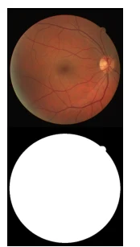
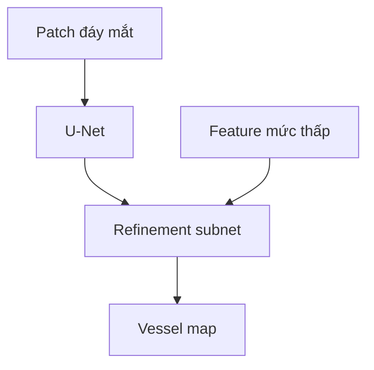

# DRIVE · Mạch máu mảnh

Ảnh đáy mắt + field-of-view → binary vessel mask.

**Metric** · F1 và ROC-AUC trong FOV ↑ cho bài luyện

**Đề luyện 5 tiếng** · Chia theo bệnh nhân/ảnh trước khi lấy patch, dùng ảnh train để tạo dev, giữ test theo điều kiện truy cập. [Dữ liệu và điều kiện truy cập](https://drive.grand-challenge.org/).

Chỉ các pixel trong vùng quan sát có ý nghĩa khi đánh giá. *Trích Hình 4a, trường nhìn DRIVE, Li và cộng sự.* [PDF gốc, trang 5](https://openaccess.thecvf.com/content_WACV_2020/papers/Li_IterNet_Retinal_Image_Segmentation_Utilizing_Structural_Redundancy_in_Vessel_Networks_WACV_2020_paper.pdf#page=5).

## Từ baseline đến mô hình mạnh

1. **Baseline.** Dùng green channel, lọc đường mảnh nhiều hướng rồi threshold dev.
2. **Thử nghiệm tiếp theo.** Plot recall theo độ dày mạch. Train U-Net bằng patch có mạch, so BCE với BCE + Dice.
3. **Kiến trúc nghiên cứu.** IterNet tái sử dụng nhiều subnetwork nhỏ để tinh chỉnh mạch bị đứt, đánh giá theo ảnh và trong FOV.

## Kiến trúc để thử

Khối code có thể tái sử dụng · [Loader ảnh và target pixel với hình học đồng bộ](../blocks/masks.py).

## Mốc công bố và hướng SOTA

Bảng 1 IterNet báo hiệu năng DRIVE trong field-of-view. So AUC/F1 chỉ khi mask và threshold rule khớp. [Thí nghiệm hoặc kiến trúc gốc, tr. 8](https://openaccess.thecvf.com/content_WACV_2020/papers/Li_IterNet_Retinal_Image_Segmentation_Utilizing_Structural_Redundancy_in_Vessel_Networks_WACV_2020_paper.pdf#page=8).

SA-UNet thêm spatial attention ở U-Net. Đánh giá recall mạch mảnh và AUC trong đúng FOV. [Paper hoặc bảng đối chiếu](https://doi.org/10.1109/ICPR48806.2021.9413346).

[← Trở về danh sách 30 challenge](../README.md)
