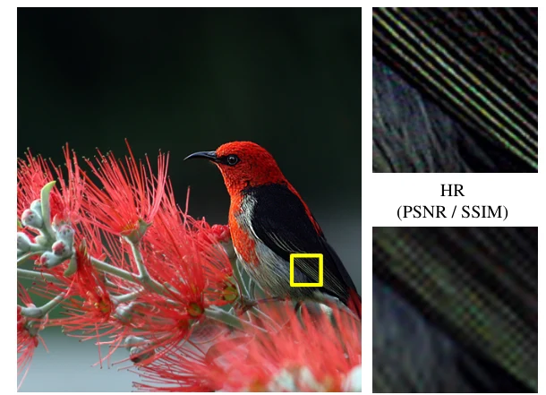
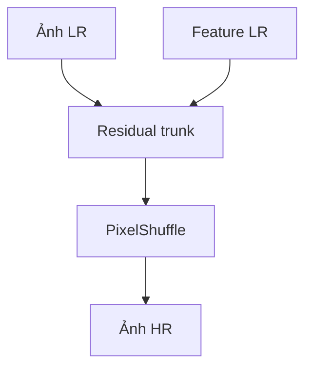

# DIV2K · Super-resolution ×4

LR bicubic → RGB HR với cùng trường nhìn.

**Metric** · PSNR ↑, bài luyện dùng kênh Y và shave 4 px, ghi rõ protocol

**Đề luyện 5 tiếng** · Lấy crop HR 96² rồi suy tọa độ LR tương ứng, chia theo ảnh gốc. [Dữ liệu và điều kiện truy cập](https://data.vision.ee.ethz.ch/cvl/DIV2K/).

So cạnh và hoa văn ở cùng vùng phóng đại để thấy phần bicubic bỏ mất. *Trích Hình 1, patch ×4 trong paper EDSR, Lim và cộng sự.* [PDF gốc, trang 1](https://arxiv.org/pdf/1707.02921#page=1).

## Từ baseline đến mô hình mạnh

1. **Baseline.** Bicubic upscale ×4.
2. **Thử nghiệm tiếp theo.** So residual với ảnh bicubic. Cho CNN chạy trong không gian LR, PixelShuffle ở cuối, đo đường viền và texture.
3. **Kiến trúc nghiên cứu.** EDSR bỏ batch norm trong residual blocks, so với bản nhỏ cùng số bước.

## Kiến trúc để thử

Khối code có thể tái sử dụng · [Encoder–decoder có skip để tham khảo cho head dự đoán dày](../blocks/models.py).

## Mốc công bố và hướng SOTA

Bảng 4 ghi kết quả đội EDSR ở NTIRE 2017, gồm các track bicubic và unknown degradation. Xác định đúng ×4 và đặt cùng phép downsample. [Thí nghiệm hoặc kiến trúc gốc, tr. 8](https://arxiv.org/pdf/1707.02921#page=8).

HAT mở rộng phạm vi tương tác giữa patch trong image SR. So cùng scale, crop biên và test-time ensemble. [Paper hoặc bảng đối chiếu](https://openaccess.thecvf.com/content/CVPR2023/html/Chen_Activating_More_Pixels_in_Image_Super-Resolution_Transformer_CVPR_2023_paper.html).

[← Trở về danh sách 30 challenge](../README.md)
