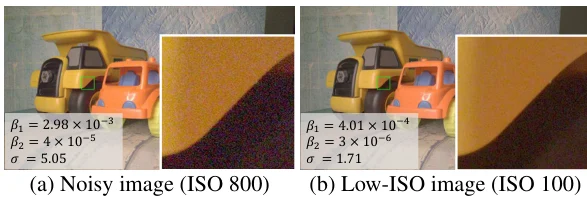
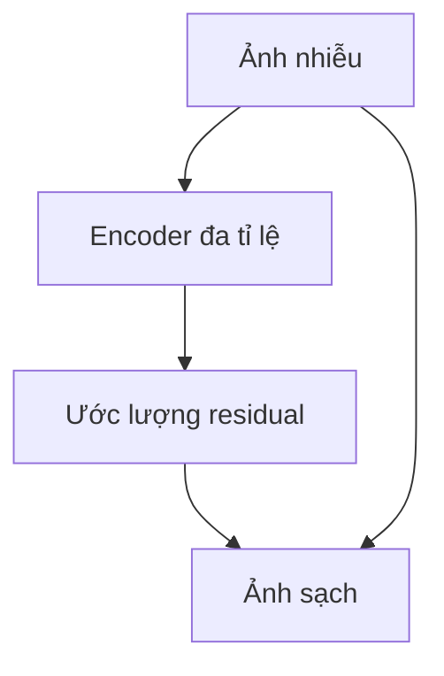

# SIDD · Khử nhiễu camera thật

Crop sRGB nhiễu → sRGB sạch được ghép cặp.

**Metric** · PSNR và SSIM ↑, cùng không gian sRGB

**Đề luyện 5 tiếng** · Lấy SIDD Medium, group theo scene/camera trước khi crop. Không trộn RAW với sRGB. [Dữ liệu và điều kiện truy cập](https://abdokamel.github.io/sidd/).

Ghép đúng điều kiện chụp giúp xác định nhiễu thay vì khác cảnh. *Trích Hình 1, các phiên bản cùng cảnh, Abdelhamed, Lin & Brown.* [PDF gốc, trang 1](https://openaccess.thecvf.com/content_cvpr_2018/papers/Abdelhamed_A_High-Quality_Denoising_CVPR_2018_paper.pdf#page=1).

## Từ baseline đến mô hình mạnh

1. **Baseline.** Median filter hoặc Gaussian blur với sigma chọn trên dev.
2. **Thử nghiệm tiếp theo.** Blur làm mất vân thật. Train CNN dự đoán noise residual, xem sai số theo vùng tối.
3. **Kiến trúc nghiên cứu.** Restormer dùng attention trên chiều kênh và xử lý đa tỉ lệ, thử block nhỏ trên cùng patch.

## Kiến trúc để thử

Khối code có thể tái sử dụng · [Encoder–decoder có skip để tham khảo cho head dự đoán dày](../blocks/models.py).

## Mốc công bố và hướng SOTA

Bảng 6 của Restormer là real-image denoising trên SIDD/DND. Các bảng noise Gaussian dùng giao thức khác. [Thí nghiệm hoặc kiến trúc gốc, tr. 7](https://openaccess.thecvf.com/content/CVPR2022/papers/Zamir_Restormer_Efficient_Transformer_for_High-Resolution_Image_Restoration_CVPR_2022_paper.pdf#page=7).

NAFNet là mốc restoration có thực nghiệm SIDD và GoPro. So width, MACs và giao thức test trước khi chọn block đem vào bản nhỏ. [Paper hoặc bảng đối chiếu](https://www.ecva.net/papers/eccv_2022/papers_ECCV/papers/136670017.pdf).

[← Trở về danh sách 30 challenge](../README.md)
