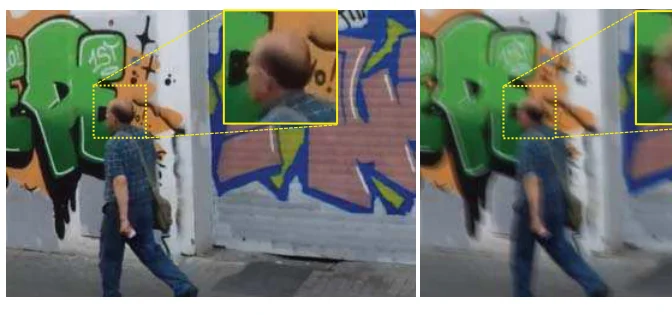
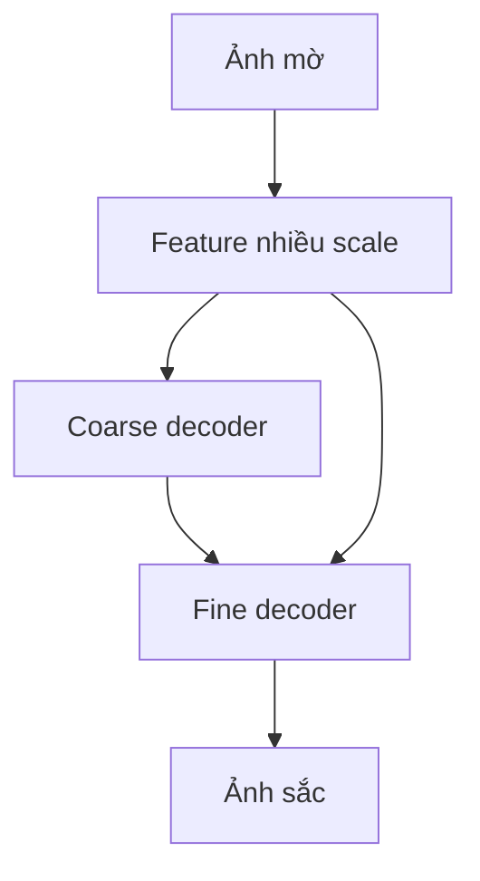

# GoPro · Khử nhòe chuyển động

Ảnh blur → frame sharp thẳng hàng.

**Metric** · PSNR và SSIM ↑

**Đề luyện 5 tiếng** · Chọn clip train, tách validation theo sequence rồi lấy cặp crop 128². [Dữ liệu và điều kiện truy cập](https://seungjunnah.github.io/Datasets/gopro).

So vật chuyển động trong cùng trường nhìn trước khi lấy patch. *Trích Hình 2, cặp ảnh trong paper, Nah, Kim & Lee.* [PDF gốc, trang 4](https://openaccess.thecvf.com/content_cvpr_2017/papers/Nah_Deep_Multi-Scale_Convolutional_CVPR_2017_paper.pdf#page=4).

## Từ baseline đến mô hình mạnh

1. **Baseline.** Identity blur → output, sau đó residual CNN 3×3.
2. **Thử nghiệm tiếp theo.** Phân PSNR theo độ mạnh nhòe. Thêm nhánh coarse-to-fine để tăng receptive field.
3. **Kiến trúc nghiên cứu.** MIMO-UNet dùng multi-input và multi-output nhiều tỉ lệ cho deblurring trên GoPro.

## Kiến trúc để thử

Khối code có thể tái sử dụng · [Encoder–decoder có skip để tham khảo cho head dự đoán dày](../blocks/models.py).

## Mốc công bố và hướng SOTA

Bảng 1, GoPro test. MIMO-UNet đạt 31,73 dB và MIMO-UNet+ đạt 32,45 dB. Ghi chi phí khi thêm self-ensemble. [Thí nghiệm hoặc kiến trúc gốc, tr. 7](https://openaccess.thecvf.com/content/ICCV2021/papers/Cho_Rethinking_Coarse-To-Fine_Approach_in_Single_Image_Deblurring_ICCV_2021_paper.pdf#page=7).

NAFNet là mốc restoration có thực nghiệm SIDD và GoPro. So width, MACs và giao thức test trước khi chọn block đem vào bản nhỏ. [Paper hoặc bảng đối chiếu](https://www.ecva.net/papers/eccv_2022/papers_ECCV/papers/136670017.pdf).

[← Trở về danh sách 30 challenge](../README.md)
