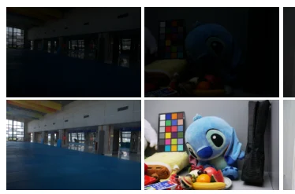
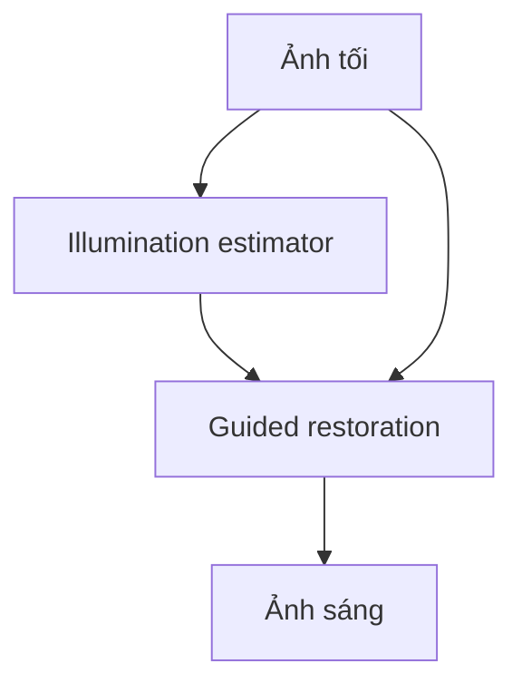

# LOL-v1 · Tăng sáng ảnh tối

Ảnh thiếu sáng → ảnh phơi sáng chuẩn của cùng cảnh.

**Metric** · PSNR, SSIM ↑ so với ảnh chuẩn

**Đề luyện 5 tiếng** · Luyện trên cặp ảnh trong LOL-v1, tạo dev từ train theo cặp cảnh. Chốt một protocol sRGB. [Dữ liệu và điều kiện truy cập](https://daooshee.github.io/BMVC2018website/).

Vùng tối gần bão hòa đen giữ lại ít thông tin texture. *Trích Hình 3, cặp thiếu sáng và đủ sáng, Wei và cộng sự.* [PDF gốc, trang 7](https://arxiv.org/pdf/1808.04560#page=7).

## Từ baseline đến mô hình mạnh

1. **Baseline.** Chỉnh gamma, chọn số mũ trên dev.
2. **Thử nghiệm tiếp theo.** Đo lệch màu vùng sáng và nhiễu vùng tối. Học illumination map theo pixel, regularize total variation.
3. **Kiến trúc nghiên cứu.** Retinexformer học ước lượng ánh sáng rồi phục hồi vùng bị nhiễu dưới hướng dẫn của illumination.

## Kiến trúc để thử

Khối code có thể tái sử dụng · [Encoder–decoder có skip để tham khảo cho head dự đoán dày](../blocks/models.py).

## Mốc công bố và hướng SOTA

Bảng 1 tách LOL-v1, LOL-v2-real và LOL-v2-synthetic. Retinexformer báo 25,16 dB và SSIM 0,845 trên LOL-v1. [Thí nghiệm hoặc kiến trúc gốc, tr. 6](https://openaccess.thecvf.com/content/ICCV2023/papers/Cai_Retinexformer_One-stage_Retinex-based_Transformer_for_Low-light_Image_Enhancement_ICCV_2023_paper.pdf#page=6).

SNR-Aware phân phối xử lý theo mức nhiễu. So màu và PSNR ở vùng tối với Retinex decomposition. [Paper hoặc bảng đối chiếu](https://openaccess.thecvf.com/content/CVPR2022/html/Xu_SNR-Aware_Low-Light_Image_Enhancement_CVPR_2022_paper.html).

[← Trở về danh sách 30 challenge](../README.md)
