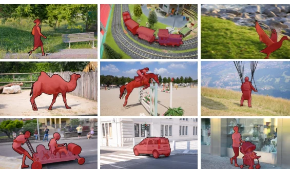
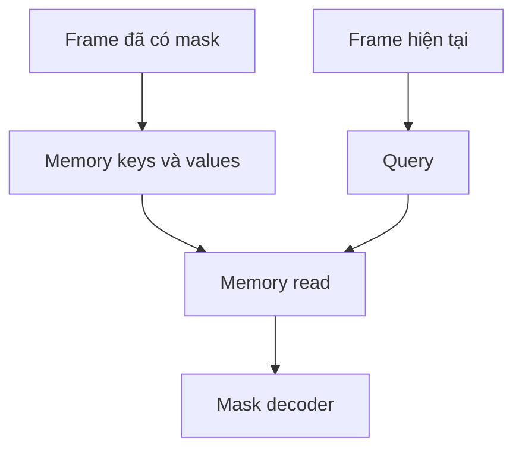

# DAVIS 2016 · Theo vật thể bằng mask frame đầu

Video + mask foreground frame 1 → mask tất cả frame sau.

**Metric** · Trung bình J và F ↑

**Đề luyện 5 tiếng** · Dùng single-object 2016, lấy clip ngắn, chia theo video, bỏ frame khởi tạo khi tự chấm. [Dữ liệu và điều kiện truy cập](https://davischallenge.org/).

Một mask có thể biến dạng mạnh khi vật chuyển động qua các frame. *Trích Hình 1, sample sequences, Perazzi và cộng sự.* [PDF gốc, trang 1](https://openaccess.thecvf.com/content_cvpr_2016/papers/Perazzi_A_Benchmark_Dataset_CVPR_2016_paper.pdf#page=1).

## Từ baseline đến mô hình mạnh

1. **Baseline.** Copy mask frame trước.
2. **Thử nghiệm tiếp theo.** So J và boundary F theo khoảng cách đến frame đầu. Warp mask bằng optical flow, rồi ghép feature frame đầu để sửa drift.
3. **Kiến trúc nghiên cứu.** Space-Time Memory Networks truy vấn mask từ memory frame đã gán, giữ protocol semi-supervised.

## Kiến trúc để thử

Khối code có thể tái sử dụng · [Loader ảnh và target pixel với hình học đồng bộ](../blocks/masks.py).

## Mốc công bố và hướng SOTA

Bảng 2 STM là DAVIS 2016. Bảng 3 đánh giá bản multi-object DAVIS 2017 riêng. [Thí nghiệm hoặc kiến trúc gốc, tr. 6](https://arxiv.org/pdf/1904.00607#page=6).

Cutie dùng object-level memory cho video segmentation, thử so memory giới hạn và đầy đủ trên cùng sequence. [Paper hoặc bảng đối chiếu](https://openaccess.thecvf.com/content/CVPR2024/html/Cheng_Putting_the_Object_Back_into_Video_Object_Segmentation_CVPR_2024_paper.html).

[← Trở về danh sách 30 challenge](../README.md)
