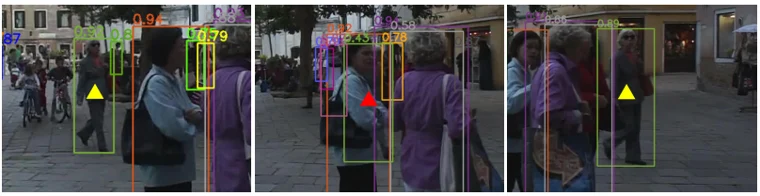
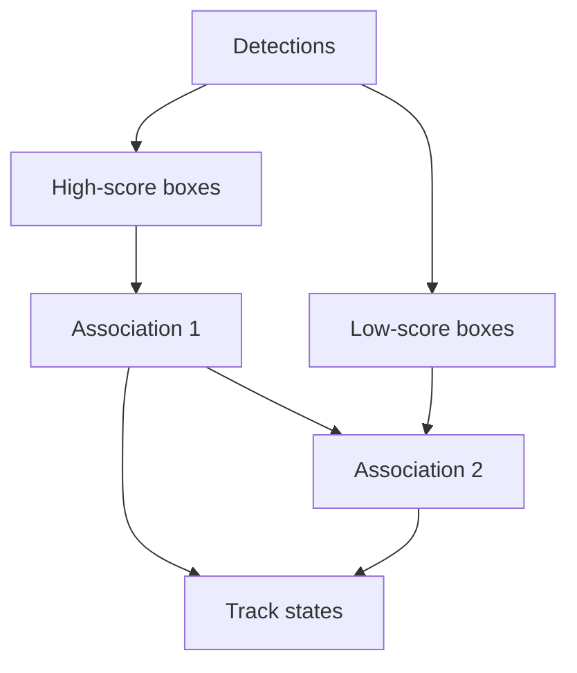

# MOT17 · Ghép detection thành trajectory

Bbox theo frame + confidence → ID nhất quán theo thời gian.

**Metric** · IDF1, HOTA ↑ qua TrackEval

**Đề luyện 5 tiếng** · Dùng public detections một detector trên 2 sequence train, chia theo sequence và chốt detections để so association. [Dữ liệu và điều kiện truy cập](https://motchallenge.net/data/MOT17/).

Theo cùng màu ID qua ba frame để phân biệt mất detection và đổi ID. *Trích Hình 5, một sequence MOT17, Zhang và cộng sự.* [PDF gốc, trang 11](https://arxiv.org/pdf/2110.06864#page=11).

## Từ baseline đến mô hình mạnh

1. **Baseline.** Ghép IoU giữa frame liên tiếp bằng Hungarian.
2. **Thử nghiệm tiếp theo.** Đếm ID switches sau che khuất. Thêm Kalman motion và tuổi track, giữ box confidence thấp cho vòng ghép thứ hai.
3. **Kiến trúc nghiên cứu.** ByteTrack tách detections thành hai ngưỡng score trước khi association, đánh giá với cùng detections.

## Kiến trúc để thử

Khối code có thể tái sử dụng · [Pairwise IoU và association bằng Hungarian](../blocks/tracking.py).

## Mốc công bố và hướng SOTA

ByteTrack trên MOT17 test báo 80,3 MOTA, 77,3 IDF1, 63,1 HOTA. Trong bài rút gọn giữ cố định detector để cô lập association. [Thí nghiệm hoặc kiến trúc gốc, tr. 8](https://arxiv.org/pdf/2110.06864#page=8).

Dùng bảng MOT17 để đối chiếu các tracker theo public/private detections, HOTA và IDF1. Giữ cùng detector trong thí nghiệm association. [Paper hoặc bảng đối chiếu](https://motchallenge.net/results/MOT17/).

[← Trở về danh sách 30 challenge](../README.md)
