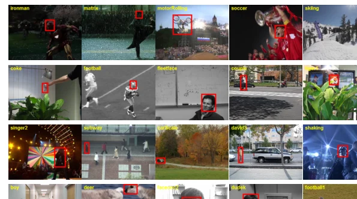
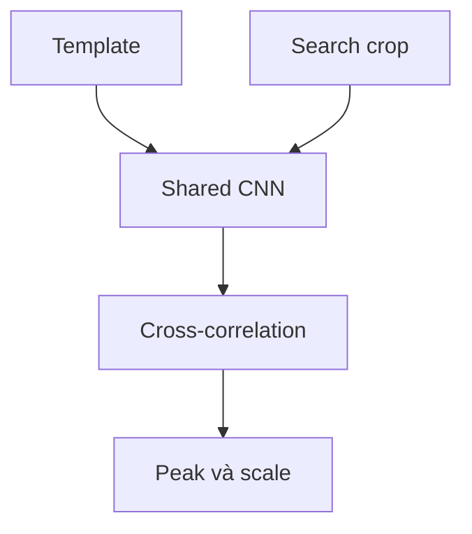

# OTB-100 · Single-object tracking

Box đầu + từng frame → đúng một box trong mỗi frame.

**Metric** · AUC success plot ↑ cho one-pass evaluation

**Đề luyện 5 tiếng** · Chọn 15 video có occlusion hoặc scale change. Dùng frame đầu để khởi tạo, không reset sau khi mất dấu. [Dữ liệu và điều kiện truy cập](https://github.com/foolwood/benchmark_results).

Box frame đầu là tín hiệu khởi tạo cho bài tracking; OTB-100 là bản mở rộng. *Trích Hình 1 của benchmark OTB đời đầu, Wu, Lim & Yang.* [PDF gốc, trang 4](https://openaccess.thecvf.com/content_cvpr_2013/papers/Wu_Online_Object_Tracking_2013_CVPR_paper.pdf#page=4).

## Từ baseline đến mô hình mạnh

1. **Baseline.** Template matching quanh box trước.
2. **Thử nghiệm tiếp theo.** Đo IoU trước và sau occlusion. Thử nhiều scale và chỉ cập nhật template khi peak đủ rõ.
3. **Kiến trúc nghiên cứu.** SiamFC tương quan template và vùng tìm trên feature map do cùng encoder tạo ra.

## Kiến trúc để thử

Khối code có thể tái sử dụng · [Pairwise IoU và association bằng Hungarian](../blocks/tracking.py).

## Mốc công bố và hướng SOTA

SiamFC có thí nghiệm OTB với success và precision plot, dùng cùng one-pass protocol, bộ video và khởi tạo. [Thí nghiệm hoặc kiến trúc gốc, tr. 12](https://arxiv.org/pdf/1606.09549#page=12).

ECO là hướng correlation-filter hiệu quả. So OPE success AUC với SiamFC và ghi số lần cập nhật filter. [Paper hoặc bảng đối chiếu](https://openaccess.thecvf.com/content_cvpr_2017/papers/Danelljan_ECO_Efficient_Convolution_CVPR_2017_paper.pdf).

[← Trở về danh sách 30 challenge](../README.md)
