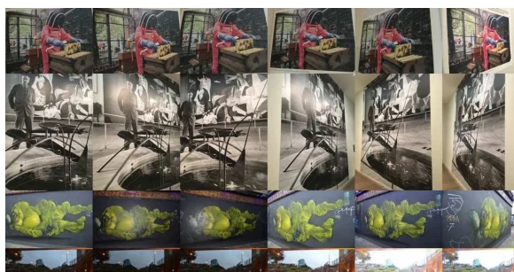
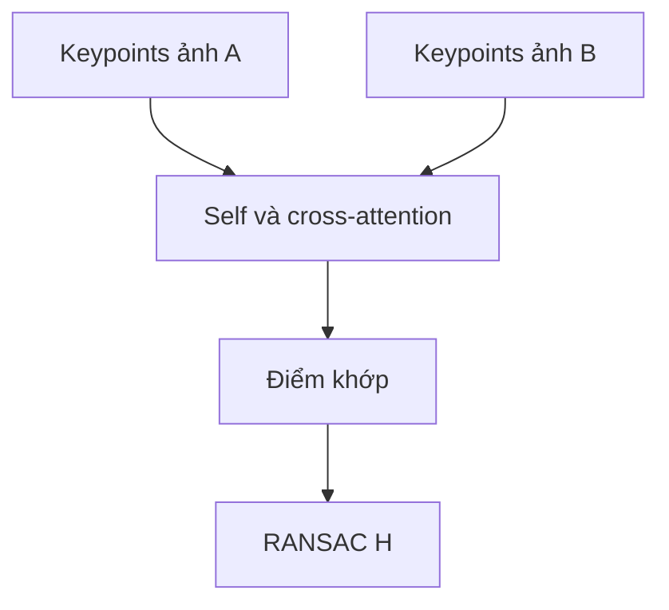

# HPatches · Ghép điểm giữa hai góc nhìn

Hai ảnh + H ground truth khi chấm → keypoint matches và homography.

**Metric** · MMA@3px ↑ trên matches, corner error ↓ trong bài luyện

**Đề luyện 5 tiếng** · Tách illumination/viewpoint sequences, chỉ dùng H để chấm hoặc tạo cặp train khác sequence. [Dữ liệu và điều kiện truy cập](https://github.com/hpatches/hpatches-dataset).

Đổi sáng và đổi góc nhìn tác động khác nhau lên khả năng match. *Trích Hình 1, sample sequences, Balntas và cộng sự.* [PDF gốc, trang 4](https://openaccess.thecvf.com/content_cvpr_2017/papers/Balntas_HPatches_A_Benchmark_CVPR_2017_paper.pdf#page=4).

## Từ baseline đến mô hình mạnh

1. **Baseline.** SIFT + ratio test + RANSAC.
2. **Thử nghiệm tiếp theo.** Đếm inlier trước và sau RANSAC theo loại biến đổi. Thử mutual NN rồi learned matcher giữ nguyên keypoints.
3. **Kiến trúc nghiên cứu.** LightGlue dùng attention luân phiên giữa hai tập keypoint và dừng sớm trên cặp dễ.

## Kiến trúc để thử

Khối code có thể tái sử dụng · [Bản đồ code và quy ước tensor của nhánh CV](../README.md).

## Mốc công bố và hướng SOTA

LightGlue so matching và homography ở các ngưỡng sai số. Đọc tên metric trước khi đặt cạnh MMA của bài tập. [Thí nghiệm hoặc kiến trúc gốc, tr. 6](https://openaccess.thecvf.com/content/ICCV2023/papers/Lindenberger_LightGlue_Local_Feature_Matching_at_Light_Speed_ICCV_2023_paper.pdf#page=6).

LoFTR bỏ bước phát hiện keypoint. Trên vùng ít texture, so số inlier và corner error cùng ngưỡng RANSAC. [Paper hoặc bảng đối chiếu](https://openaccess.thecvf.com/content/CVPR2021/papers/Sun_LoFTR_Detector-Free_Local_Feature_Matching_With_Transformers_CVPR_2021_paper.pdf).

[← Trở về danh sách 30 challenge](../README.md)
