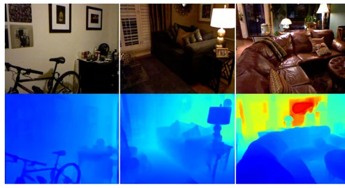
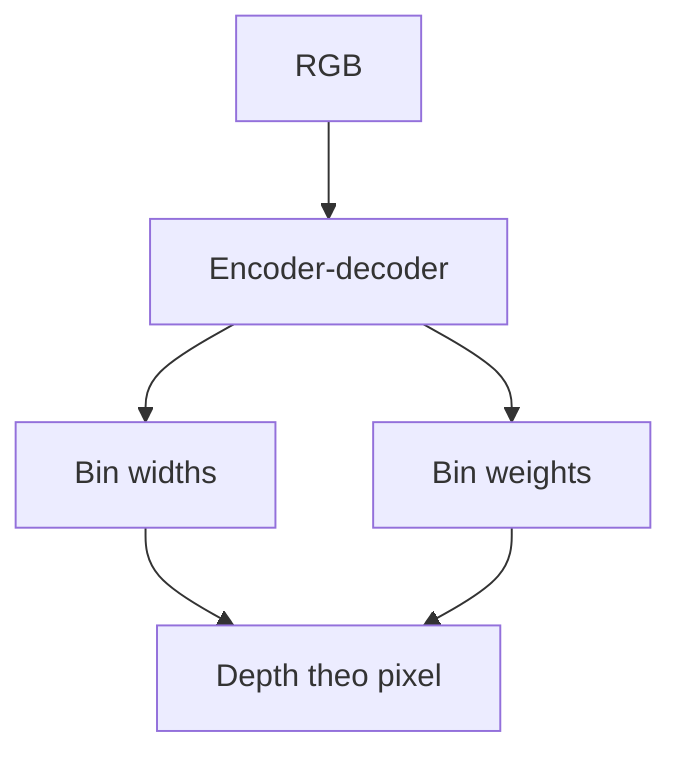

# NYU Depth v2 · Depth từ một ảnh RGB

Ảnh phòng → bản đồ depth theo mét.

**Metric** · AbsRel ↓ và δ1 ↑ với valid-depth mask

**Đề luyện 5 tiếng** · Dùng labeled split theo scene, resize cùng hình học cho RGB/depth, bỏ depth bằng 0. [Dữ liệu và điều kiện truy cập](https://cs.nyu.edu/~fergus/datasets/nyu_depth_v2.html).

Ranh giới vật thể cung cấp dấu hiệu hình học cho depth monocular. *Trích Hình 1 trong AdaBins, RGB và dự đoán depth, Bhat, Alhashim & Wonka.* [PDF gốc, trang 1](https://openaccess.thecvf.com/content/CVPR2021/papers/Bhat_AdaBins_Depth_Estimation_Using_Adaptive_Bins_CVPR_2021_paper.pdf#page=1).

## Từ baseline đến mô hình mạnh

1. **Baseline.** Dự đoán median depth theo hàng ảnh học từ train.
2. **Thử nghiệm tiếp theo.** Đo AbsRel theo khoảng cách. CNN encoder–decoder học log-depth, so với median theo pixel.
3. **Kiến trúc nghiên cứu.** AdaBins học biên depth bins theo ảnh và lấy tổ hợp trọng số để suy depth liên tục.

## Kiến trúc để thử

Khối code có thể tái sử dụng · [Encoder–decoder có skip để tham khảo cho head dự đoán dày](../blocks/models.py).

## Mốc công bố và hướng SOTA

Bảng 2 AdaBins báo NYU-Depth-v2. Giữ đúng depth cap, crop và đơn vị mét. [Thí nghiệm hoặc kiến trúc gốc, tr. 6](https://openaccess.thecvf.com/content/CVPR2021/papers/Bhat_AdaBins_Depth_Estimation_Using_Adaptive_Bins_CVPR_2021_paper.pdf#page=6).

Depth Anything V2 có checkpoint relative và metric. Chọn metric indoor cho AbsRel, ghi ánh xạ đơn vị và kiểu fine-tuning. [Paper hoặc bảng đối chiếu](https://depth-anything-v2.github.io/).

[← Trở về danh sách 30 challenge](../README.md)
