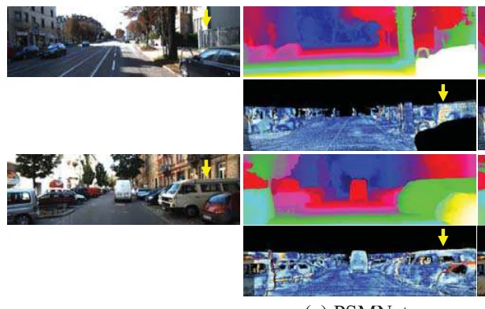
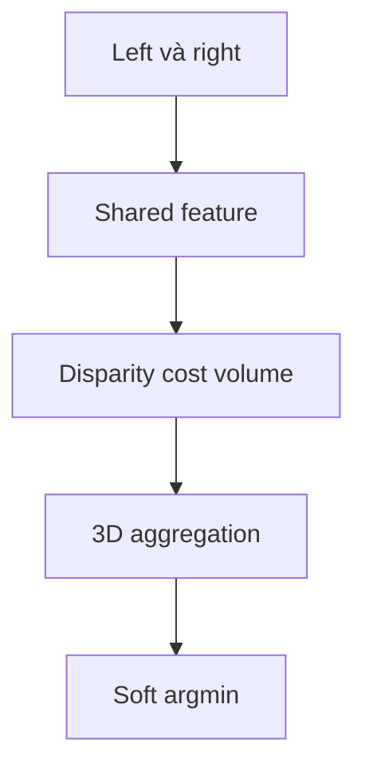

# KITTI Stereo 2015 · Disparity

Cặp trái/phải rectified → disparity của ảnh trái.

**Metric** · D1-all ↓, bad nếu sai >3 px và >5% trên valid mask

**Đề luyện 5 tiếng** · Chia theo cặp stereo, crop cùng vùng hai ảnh, đổi hệ số disparity khi resize ngang. [Dữ liệu và điều kiện truy cập](https://www.cvlibs.net/datasets/kitti/eval_scene_flow.php?benchmark=stereo).

Biên vật và vùng ít texture khó ghép giữa hai ảnh stereo. *Trích Hình 2, kết quả disparity, Chang & Chen.* [PDF gốc, trang 7](https://openaccess.thecvf.com/content_cvpr_2018/papers/Chang_Pyramid_Stereo_Matching_CVPR_2018_paper.pdf#page=7).

## Từ baseline đến mô hình mạnh

1. **Baseline.** Block matching SAD trên cùng một hàng.
2. **Thử nghiệm tiếp theo.** Kiểm tra bad-pixel trên vật mỏng và nền lặp. Thêm census hoặc smoothness trước khi học cost aggregation.
3. **Kiến trúc nghiên cứu.** PSMNet dùng spatial pyramid và cost volume 3D, thu nhỏ max disparity trong bài luyện.

## Kiến trúc để thử

Khối code có thể tái sử dụng · [Encoder–decoder có skip để tham khảo cho head dự đoán dày](../blocks/models.py).

## Mốc công bố và hướng SOTA

Bảng 4 PSMNet chụp KITTI 2015 leaderboard tại thời điểm công bố, đọc riêng D1-bg, D1-fg và D1-all. [Thí nghiệm hoặc kiến trúc gốc, tr. 7](https://openaccess.thecvf.com/content_cvpr_2018/papers/Chang_Pyramid_Stereo_Matching_CVPR_2018_paper.pdf#page=7).

FoundationStereo là mốc zero-shot. So D1-all ở chế độ không thích nghi trước khi thử fine-tune trên KITTI. [Paper hoặc bảng đối chiếu](https://openaccess.thecvf.com/content/CVPR2025/html/Wen_FoundationStereo_Zero-Shot_Stereo_Matching_CVPR_2025_paper.html).

[← Trở về danh sách 30 challenge](../README.md)
