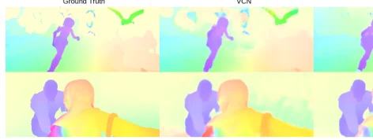
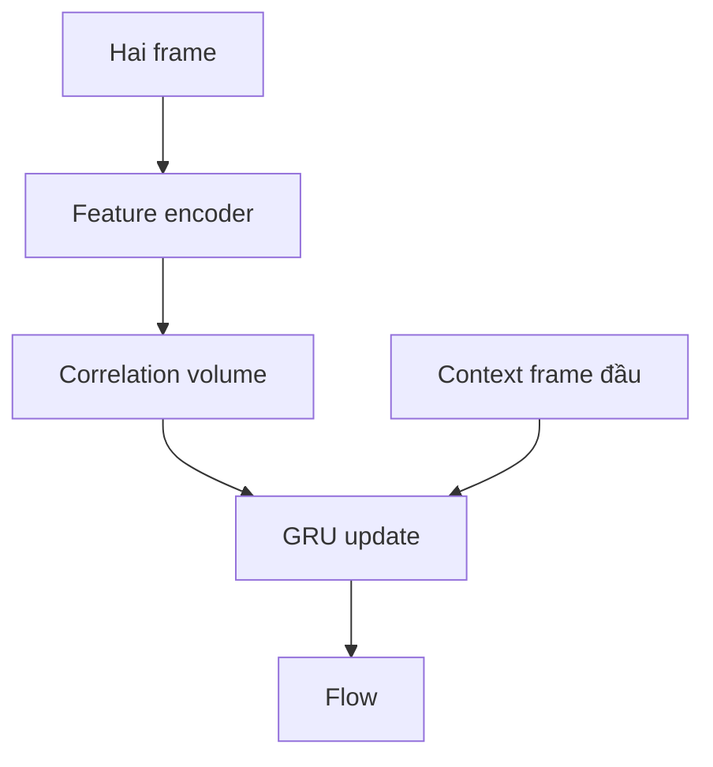

# MPI Sintel · Optical flow

Hai frame liên tiếp → vector u,v cho từng pixel.

**Metric** · Mean endpoint error ↓, tách clean/final

**Đề luyện 5 tiếng** · Chọn vài sequence train, giữ cả clean/final của cùng scene trong cùng split. [Dữ liệu và điều kiện truy cập](https://sintel.is.tue.mpg.de/hero).

Màu biểu diễn hướng và độ lớn của flow, nên cần khôi phục đúng hệ pixel. *Trích Hình 3, flow predictions, Teed & Deng.* [PDF gốc, trang 9](https://arxiv.org/pdf/2003.12039#page=9).

## Từ baseline đến mô hình mạnh

1. **Baseline.** Lucas–Kanade hoặc Farnebäck dense flow.
2. **Thử nghiệm tiếp theo.** Tách EPE theo độ lớn chuyển động. Thử pyramid để bắt displacement lớn, kiểm tra lại scale u,v sau resize.
3. **Kiến trúc nghiên cứu.** RAFT xây all-pairs correlation và cập nhật flow lặp, dùng weights offline khi được phép.

## Kiến trúc để thử

Khối code có thể tái sử dụng · [Encoder–decoder có skip để tham khảo cho head dự đoán dày](../blocks/models.py).

## Mốc công bố và hướng SOTA

RAFT tách train/test và clean/final. Điều kiện pretraining và fine-tune trên Sintel ảnh hưởng trực tiếp EPE. [Thí nghiệm hoặc kiến trúc gốc, tr. 8](https://arxiv.org/pdf/2003.12039#page=8).

SEA-RAFT bổ sung cách huấn luyện và ước lượng flow cho RAFT. So clean/final EPE với số vòng cập nhật cố định. [Paper hoặc bảng đối chiếu](https://www.ecva.net/papers/eccv_2024/papers_ECCV/papers/01065.pdf).

[← Trở về danh sách 30 challenge](../README.md)
