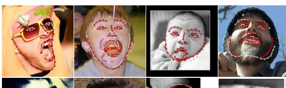
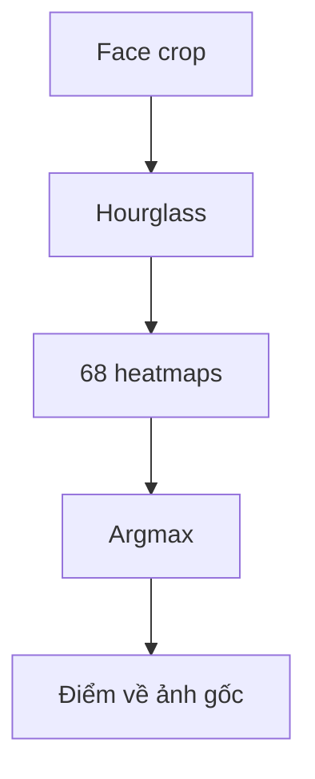

# 300-W · Landmark khuôn mặt

Face crop → 68 tọa độ theo thứ tự chuẩn.

**Metric** · NME ↓ chuẩn hóa khoảng cách hai khóe mắt ngoài, ghi rõ protocol

**Đề luyện 5 tiếng** · Chia theo ảnh nguồn, tách common/challenging, chỉ lấy crop theo cùng quy ước box. [Dữ liệu và điều kiện truy cập](https://ibug.doc.ic.ac.uk/resources/300-W/).

Mặt nghiêng và che khuất tạo các lỗi landmark lớn. *Trích Hình 4, hàng 300-W, Bulat & Tzimiropoulos.* [PDF gốc, trang 5](https://openaccess.thecvf.com/content_ICCV_2017/papers/Bulat_How_Far_Are_ICCV_2017_paper.pdf#page=5).

## Từ baseline đến mô hình mạnh

1. **Baseline.** Mean shape train trong tọa độ box chuẩn hóa.
2. **Thử nghiệm tiếp theo.** Đo NME theo yaw, flip phải hoán đổi index mắt, mày, môi. So vector regression với heatmap regression.
3. **Kiến trúc nghiên cứu.** FAN dùng stacked hourglass và heatmaps, đánh giá landmark trên 300-W.

## Kiến trúc để thử

Khối code có thể tái sử dụng · [Bản đồ code và quy ước tensor của nhánh CV](../README.md).

## Mốc công bố và hướng SOTA

Bảng 2 FAN dùng AUC tại ngưỡng lỗi 7%, bài luyện báo NME. Ghi rõ chuẩn hóa mặt khi đánh giá. [Thí nghiệm hoặc kiến trúc gốc, tr. 6](https://openaccess.thecvf.com/content_ICCV_2017/papers/Bulat_How_Far_Are_ICCV_2017_paper.pdf#page=6).

Adaptive Wing Loss coi các điểm lỗi vừa phải trong heatmap khác với nền. So NME theo cùng quy ước kích thước mặt. [Paper hoặc bảng đối chiếu](https://openaccess.thecvf.com/content_ICCV_2019/html/Wang_Adaptive_Wing_Loss_for_Robust_Face_Alignment_via_Heatmap_Regression_ICCV_2019_paper.html).

[← Trở về danh sách 30 challenge](../README.md)
